# AI Control Tower and the IRGF

How AI Control Tower applies the **Intent-to-Runtime Governance Framework** (IRGF v1.0,
<https://www.irgframework.org/>), what Phases 1 to 4 implement, and what comes next. Stage (S0–S10), gate
(G1–G5), dimension (D1–D5) and module (M1–M20) identifiers are IRGF's own.

For installation, configuration and the full API, see the [Technical Guide](technical-guide.md).

## Contents

1. [The fit in one paragraph](#1-the-fit-in-one-paragraph)
2. [What Phase 1 adds](#2-what-phase-1-adds)
3. [Risk classification: stage S2](#3-risk-classification-stage-s2)
4. [Tier-scoped controls](#4-tier-scoped-controls)
5. [Agent identity: chain link 02](#5-agent-identity-chain-link-02)
6. [The kill-switch: chain link 06](#6-the-kill-switch-chain-link-06)
7. [The Agent Card and the governance chain](#7-the-agent-card-and-the-governance-chain)
8. [Who does what](#8-who-does-what)
9. [A worked example](#9-a-worked-example)
10. [Phase 2: Gates G3 and G4, and M17 exceptions](#10-phase-2-gates-g3-and-g4-and-m17-exceptions)
11. [Phase 3: the Control Plane](#11-phase-3-the-control-plane)
12. [Phase 4: applications and composite authority](#12-phase-4-applications-and-composite-authority)
13. [Mapping and roadmap](#13-mapping-and-roadmap)

---

## 1. The fit in one paragraph

IRGF governs an AI system from intent to runtime: eleven lifecycle stages with five decision gates,
risk tiers derived from five scored dimensions, an eight-link governance chain for agents, and a
Control Plane that compares what is deployed against what was approved. AI Control Tower already
covered much of the runtime half — policy enforced in two gateways, evidence captured automatically,
an immutable audit trail, cost and tool-definition drift. Phase 1 adds the part everything else keys
off: a **tier for every system**, set at **S2** and **countersigned**, and puts it to work in the
controls, in agent identity and in a kill-switch.

Phases 2 to 4 build on that tier:
- **Phase 2** adds the gates that follow it: deployment authorization at **G3**, change control at
  **G4** and time-boxed exceptions under **M17** ([section 10](#10-phase-2-gates-g3-and-g4-and-m17-exceptions)).
- **Phase 3** adds the **Control Plane**, which compares what runs with what was authorized
  ([section 11](#11-phase-3-the-control-plane)).
- **Phase 4** extends authorization from agents to **applications**
  ([section 12](#12-phase-4-applications-and-composite-authority)).

## 2. What Phase 1 adds

| Capability | IRGF reference | Where |
|---|---|---|
| Risk classification record: D1–D5, tier, countersignature, history, re-score triggers | S2 · M4, M5, M6 · evidence for G1 and G2 | *AI Governance → Risk Classification*; agent and application pages |
| Tier-scoped policies and approval rules; a policy that requires a classification | M5 driving controls | Policies (`tiers` key, `risk_classification` type); approval rules (`tiers`) |
| Independent approval decisions for Tier 3–4 systems | Decision rights at Tier 3–4 | Approval Centre |
| Service accounts bound to the agents they run | Agent chain link 02 · Identity | Admin → Service accounts; both gateways |
| Suspend and resume an agent | Link 06 · Action; G3 requires a pre-approved kill-switch | Agent page; `POST /api/v1/agents/{id}/suspend/` |
| Agent Card fields and completeness check | S3 artifact, required at G3 | Agent page and its edit form; agents API |
| The eight-link chain shown per agent | M10 | Agent page |

## 3. Risk classification: stage S2

**Scoring (M4).** Each system — an agent or an application — is scored 1–4 on five dimensions:

| Dimension | Asks |
|---|---|
| D1 Decision consequence severity | How bad is it if the output is wrong and acted on? |
| D2 Autonomy | How much human judgement sits between output and effect? Score the highest-autonomy path. |
| D3 Reversibility deficit | Can the consequence in the world be undone? |
| D4 Exposure and scale | How many are affected, how far, and can it cascade? |
| D5 Sensitivity and uncertainty | Two sub-scores, data sensitivity and model uncertainty; the composite is the **higher**, never the average. |

The form suggests a starting point from the registry, and never lowers a score someone already
reasoned about: D2 from the agent's autonomy level (0–1 → 1, 2 → 2, 3 → 3, 4 → 4), D5 data
sensitivity from its data classification (public 1 · internal 2 · confidential 3 · restricted 4),
and D5 model uncertainty 3 for generative models.

**Tiering (M5).** *Impact* is the rounded-up average of D1, D4 and D5; *control deficit* the
rounded-up average of D2 and D3. The two axes stay separate, so a catastrophic factor cannot be
averaged away:

| Impact ↓ · Control deficit → | 1 | 2 | 3 | 4 |
|---|---|---|---|---|
| **4** | Tier 3 | Tier 3 | Tier 4 | Tier 4 |
| **3** | Tier 2 | Tier 2 | Tier 3 | Tier 4 |
| **2** | Tier 1 | Tier 2 | Tier 2 | Tier 3 |
| **1** | Tier 1 | Tier 1 | Tier 2 | Tier 2 |

**Safety floor.** A system with D1 = 4, or with D2 = 4 and D3 = 4 together, is never below Tier 3,
whatever the matrix says. A scorer may override the computed tier with a written rationale, but no
override can go below the floor.

**Countersignature (M6).** A new scoring is **provisional**: it can stand as the provisional D1–D5
that **Gate G1** asks for. It becomes **confirmed** — the tier **Gate G2** requires — when someone
outside the system's delivery line countersigns. The platform enforces the independence: the
scorer cannot countersign their own scoring, and neither can the agent's owner or the application's
business or technical owner. The countersigner may adjust any score, but must say why, and the
scorer's original scores are kept alongside.

**History and triggers.** Re-scoring creates a new record and supersedes the old one; nothing is
overwritten. The current record is flagged for re-scoring when:

- an agent's autonomy level increases;
- an agent's or application's data classification rises;
- an application moves to production (the population it affects changes);
- a Tier 3–4 classification reaches its annual review date (set on countersignature).

A flagged record stays in force until someone re-scores: dropping a system to "unclassified"
because its autonomy rose would make it look less risky, not more.

**Where it lives.** *AI Governance → Risk Classification* is the register: counts per tier, what
awaits countersignature, what is due for re-scoring, and every system not yet classified. Each
agent and application page shows its current classification. The tier is also on the API as
`risk_tier` (read-only) for agents and applications. The Control Tower lists production agents
without a classification, classifications awaiting countersignature, and re-scores due under
*Needs Attention*.


A record shows each score with what it means, where the system sits in the matrix, who scored and
who countersigned, and the subject's score history:

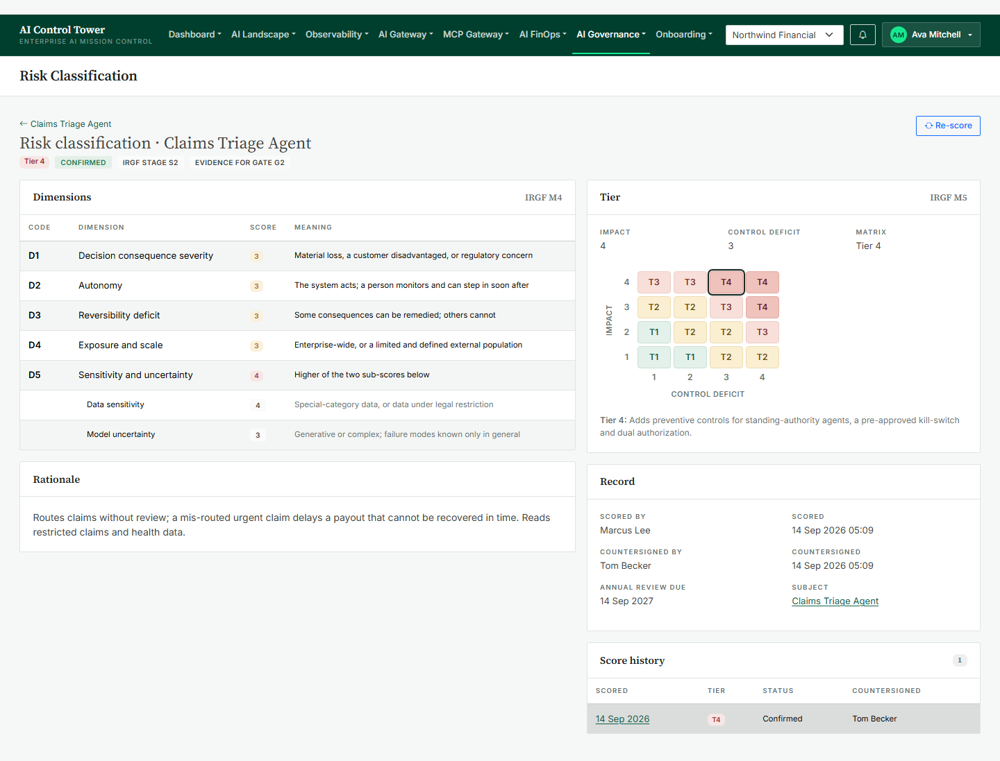

The scoring form previews the tier live as scores change, using the same rule the server applies:

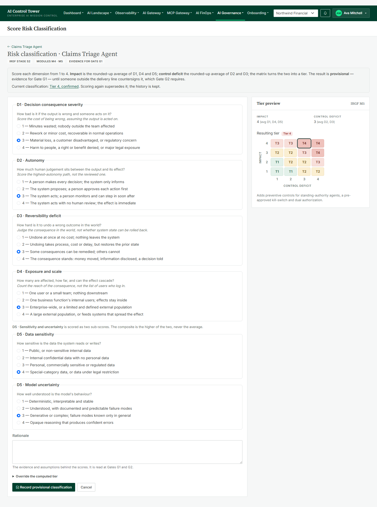

## 4. Tier-scoped controls

IRGF's principle is that the gates never change with tier — evidence depth, decision authority,
monitoring cadence and automation do. Phase 1 lets controls follow the tier.

**Any policy** accepts a `tiers` key. The policy then applies only when the higher of the agent's
and the application's tier is in the list; an unclassified system matches no tier-scoped policy.

```json
{"blocked_tools": ["issue_refund", "transfer_funds"], "tiers": [3, 4]}
```

**A risk-classification policy** (type `risk_classification`) refuses traffic from systems that
skipped S2. With no configuration it requires a current, countersigned classification. Options:
`environments`, `require_countersignature` (default `true`), `block_when_rescore_due` (default
`false`).

```json
{"environments": ["production"], "require_countersignature": true, "block_when_rescore_due": true}
```

With effect `deny`, an unclassified or unconfirmed agent is refused by both gateways — the runtime
check that S2 happened.

**Approval rules** gain a `tiers` condition, combined with the others as before (every condition a
rule specifies must match).

**Approval decisions at Tier 3–4.** When a request concerns a Tier 3 or 4 system, the person who
raised it and the system's owners cannot approve or reject it. IRGF moves Tier 3–4 decisions to a
governance body. Gate decisions apply IRGF's decision rights in full, including decision bodies and
dual authorization ([section 10](#10-phase-2-gates-g3-and-g4-and-m17-exceptions)). Approval requests
keep this simpler rule, which still keeps the decision out of the delivery line.

## 5. Agent identity: chain link 02

IRGF asks that every agent act under a registered identity of its own. A service account can now be
**bound** to the agents it runs (*Integrations* → the service account → *Edit* → *Agents it may act as*).

| Caller | Agent named | Result |
|---|---|---|
| Bound service account | One of its agents | Served |
| Bound service account | Another agent, or an unknown one | `403 identity_not_bound` |
| Bound to exactly one agent | None | Acts as that agent |
| Bound to several agents | None | `403 identity_not_bound`: name the agent |
| Unbound service account | Tier 1–2 or unclassified agent | Served, as before |
| Unbound service account | **Tier 3–4 agent** | `403 identity_not_bound` |
| Person signed in to the Control Tower | Any | Governed by their role, as before |

The rule applies to the AI Gateway (`/gateway/chat/`), agent messaging (the sender, and the agent
collecting), the MCP endpoint (`/mcp/` — refused as a JSON-RPC error with HTTP 403) and the MCP REST
pair. Existing integrations keep working until an agent reaches Tier 3, which is the point at which
IRGF insists on the separation.

## 6. The kill-switch: chain link 06

Gate G3 requires a pre-approved kill-switch for every agent that acts. Each agent now has one.

- **Suspend** from the agent page (*Kill-switch → Suspend agent*, with a reason) or over the API:
  `POST /api/v1/agents/{id}/suspend/` with `{"reason": "..."}`.
- **Effect, on the next request:** the AI Gateway answers `403 agent_suspended`; the MCP Gateway
  blocks every tool call with the reason; the agent cannot send or collect messages. The AI Gateway
  also refuses agents whose status is inactive or retired (`403 agent_inactive`) — at S10 access is
  revoked.
- **Resume** from the agent page, with an optional note. **Only a person can resume**: a service
  account may pull the switch — a monitor that sees an agent misbehave should not wait for someone —
  but people decide when it runs again. `POST /api/v1/agents/{id}/resume/` refuses service accounts.
- Both actions need the new `agent.suspend` permission (held by Organization Administrators, AI
  Platform Administrators, AI Developers, AI Governance Managers and Risk Managers), are written to
  the audit trail, and notify the agent's managers (*Agent Suspended* notifications, in-app and
  email by default).

IRGF prohibits automated corrective action at Tier 3–4 except a pre-approved kill-switch. That is
the only correction the platform automates. Since Phase 3, the Control Plane pulls the switch when a
trigger the agent pre-approved at Gate G3 fires ([section 11](#11-phase-3-the-control-plane)).

## 7. The Agent Card and the governance chain

The **Agent Card** is the record IRGF produces at S3 and requires at Gate G3 for any agent that can
act. The agent record gains the fields it was missing:

| Field | IRGF link |
|---|---|
| `out_of_scope` — what the agent is not for | 01 Agent |
| `action_limits` — `max_value_per_action`, `max_value_per_day`, `max_actions_per_hour`, `currency`, `allowed_counterparties` | 06 Action |
| `escalation_thresholds` — when it must hand over to a person | 06 Action |
| `kill_switch_conditions` — the pre-approved conditions for suspension | 06 Action |
| `kill_switch_triggers` — conditions a machine can evaluate, which suspend the agent automatically (Phase 3) | 06 Action |

Together with the existing purpose, owner and allowed tools, these make up the card. An agent at
autonomy level 2 or above, or with an allow-list of tools, **acts**, and its page lists whatever the
card still lacks. Advisory agents are exempt, as IRGF's minimum viable framework allows. Action
limits are validated — an unknown limit name is rejected, so a misspelt limit cannot pass for a set
one — and, since Phase 3, the MCP Gateway enforces them before every tool call
([section 11](#11-phase-3-the-control-plane)).

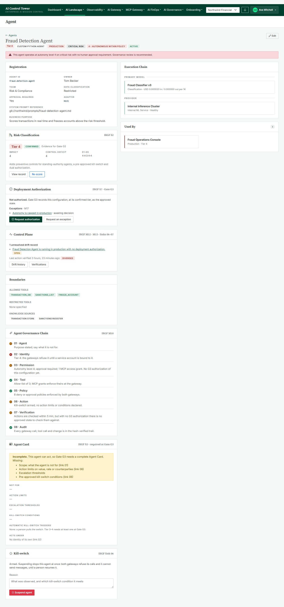

Each agent page also shows the **eight-link chain (M10)** and where the agent stands on each link:

| Link | Shown as met when |
|---|---|
| 01 Agent | Purpose and out-of-scope are both stated |
| 02 Identity | A service account is bound to it (a gap at Tier 3–4 without one) |
| 03 Permission | Autonomy level, approval requirement and MCP grants are recorded, and a Gate G3 authorization is in force (Phase 2) |
| 04 Tool | It has an explicit allow-list |
| 05 Policy | At least one deny or approval policy in scope can stop it |
| 06 Action | Action limits and kill-switch conditions are declared and it is not suspended; at Tier 3–4, at least one kill-switch trigger is automatic (Phase 3) |
| 07 Verification | Every action in the last day was verified against the authorized state within its tier's ceiling (Phase 3). Without a G3 authorization there is nothing to verify against |
| 08 Audit | Always: every call and change is in the hash-verified audit trail |

## 8. Who does what

| Act | IRGF role | Platform permission | Roles holding it |
|---|---|---|---|
| Score a system (S2) | System owner, delivery team | `agent.manage` / `application.manage`, or `risk.manage` | AI Developer, AI Platform Administrator, AI Governance Manager, Risk Manager, Org Admin |
| Countersign (M6) | Risk and Compliance Lead, independent of delivery | `risk.manage`, and not the scorer or an owner | AI Governance Manager, Risk Manager, Org Admin |
| Bind an identity (link 02) | System owner and Security | `user.manage`, on the service account's page | Organization administrators |
| Pull or release the kill-switch (link 06) | System owner, Security, on-call | `agent.suspend` (release: people only) | AI Developer, AI Platform Administrator, AI Governance Manager, Risk Manager, Org Admin |
| Decide a Tier 3–4 approval | AI Governance Body | `approval.decide`, and not the requester or an owner | AI Governance Manager, Approver, Org Admin |
| Request a G3 authorization or an exception | System owner, delivery team | `agent.manage` / `application.manage`, or being the system's owner | AI Developer, AI Platform Administrator, Org Admin, and owners |
| Decide at G3, G4 or M17 | By tier ([section 10](#10-phase-2-gates-g3-and-g4-and-m17-exceptions)): at Tier 1–2 the system owner (G3) or the Risk and Compliance Lead (G4, M17), or the AI Governance Body; at Tier 3 the Body; at Tier 4 the Body, then the Enterprise Governance Sponsor | Ownership, `risk.manage`, `gate.decide`, `gate.sponsor` | Owners, Risk Manager, AI Governance Manager, Org Admin |
| Mark a tool's action-limit arguments (link 06) | Tool reviewer | `mcp.approve` | AI Governance Manager, Org Admin |
| Revert or ratify drift (M13) | System owner, risk function or AI Governance Body | Ownership, `risk.manage` or `gate.decide` | Owners, AI Governance Manager, Risk Manager, Org Admin |
| Except or escalate drift; run the Control Plane (M12) | Risk function or AI Governance Body | `risk.manage` or `gate.decide` | AI Governance Manager, Risk Manager, Org Admin |

## 9. A worked example

1. **S2.** An AI Developer opens the *Claims Triage Agent*, chooses **Score now**, and records
   D1 3, D2 3, D3 3, D4 3, D5 data 4 / model 3 with a rationale. Impact ⌈(3+3+4)/3⌉ = 4, control
   deficit ⌈(3+3)/2⌉ = 3 → **Tier 4, provisional** (Gate G1 evidence).
2. **M6.** A Risk Manager — not the scorer, not the agent's owner — countersigns from the register.
   The tier is **confirmed** (Gate G2 evidence) and the annual review is set a year out.
3. **Link 02.** The agent is Tier 4, so the shared runtime key is now refused for it. An
   administrator creates `claims-triage-runtime`, binds it to the agent and issues it a key.
4. **Tier-scoped control.** Governance adds `"tiers": [3, 4]` to the prohibited-tools policy, so the
   restriction follows the tier rather than a list of agent names.
5. **Link 06.** The on-call engineer sees the agent approving payouts outside its limits and pulls
   the kill-switch over the API. Both gateways refuse it within one request; the owner is notified.
   After the fix, a person resumes it with a note.
6. **Trigger.** Later the agent's autonomy is raised to level 4. Its classification is flagged for
   re-scoring, and *Needs Attention* says so, until someone scores it again.
7. **G3 (Phase 2).** Re-scored and countersigned, the agent is authorized at Tier 4. The AI
   Governance Body signs, then the Enterprise Governance Sponsor, and the configuration they signed
   is frozen.
8. **G4.** An engineer widens the kill-switch conditions. That is a material change: it waits at
   Gate G4, and the authorization stays in force meanwhile.
9. **M12–M13 (Phase 3).** The engine reports a run that called `approve_payout`, a tool the
   authorization restricts. The Control Plane records a Tier 4 security incident, due the same
   business day. Once the engine is fixed, the owner reverts it.

## 10. Phase 2: Gates G3 and G4, and M17 exceptions

Phase 2 adds IRGF's deployment and change gates and its exception route, with IRGF's decision rights
behind every one of them. Everything lives under *AI Governance*: **Deployment Authorizations · G3**,
**Changes · G4** and **Exceptions · M17**. Each agent's page shows its authorization, any open changes
and its exceptions.

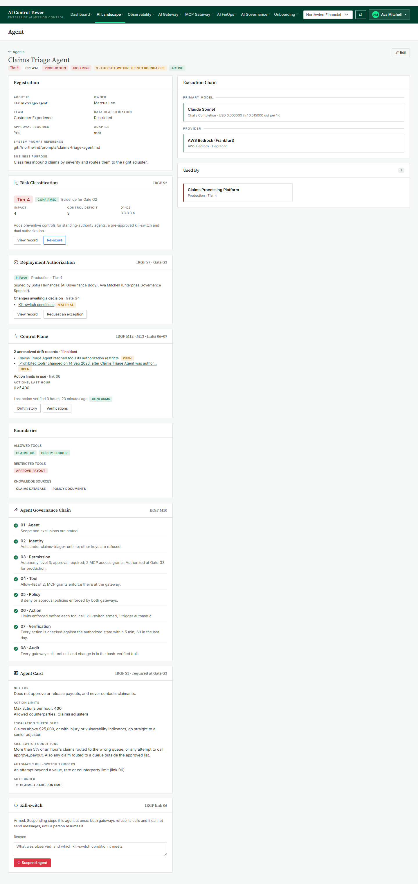

### Decision rights (M15, M16)

| Decision | Tier 1–2 | Tier 3 | Tier 4 |
|---|---|---|---|
| G3 deployment authorization | The system owner, or the AI Governance Body | AI Governance Body | AI Governance Body, then the Enterprise Governance Sponsor |
| G4 material or major change | The Risk and Compliance Lead, or the AI Governance Body | AI Governance Body | AI Governance Body, then the Enterprise Governance Sponsor |
| M17 exception | The Risk and Compliance Lead, or the AI Governance Body | AI Governance Body | AI Governance Body, then the Enterprise Governance Sponsor |

- **Tier 4 is dual authorization:** two signatures from two different people. Someone who holds
  both seats signs second when they are the only Enterprise Governance Sponsor, so a decision can
  always be completed. Anyone who may give the next signature may also refuse it.
- **From Tier 3, signers come from outside the delivery line:** neither the agent's owner nor the
  requester may sign.
- **Nobody decides a change they made or an exception they requested**, at any tier.
- **Service accounts never sign.**
- **Two new permissions:** `gate.decide` (the AI Governance Body: AI Governance Managers and
  Organization Administrators) and `gate.sponsor` (the Enterprise Governance Sponsor: Organization
  Administrators). The Risk and Compliance Lead is anyone holding `risk.manage`; the system owner is
  the agent's named owner.

### Deployment authorization (S7 · Gate G3)

An agent is authorized as **this configuration, at this tier, for this owner**. *Request
authorization* on the agent's page shows the entry criteria, scaled to its confirmed tier:

| Entry criterion | IRGF | Required from |
|---|---|---|
| Tier confirmed (countersigned, no re-score due) | S2 · G2 | Tier 1 |
| Named accountable owner; agent active and not suspended | G3 · S8 | Tier 1 |
| Tool allow-list and action limits (for agents that act) | Links 04 · 06 | Tier 1 |
| Assurance: an evaluation run of the agent or its primary model in the last year, or a written assurance summary | S6 | Tier 2 |
| A human oversight point: who reviews, with what, how fast, with what authority | G3 | Tier 2 |
| A passing evaluation in the last 180 days | S6 | Tier 3 |
| Controls mapped to specific risks in the risk register | S6 · control matrix | Tier 3 |
| Pre-approved kill-switch conditions | Link 06 | Tier 3 |
| An identity of its own | Link 02 | Tier 3 |
| Monitoring commitments | S8 | Tier 3 |

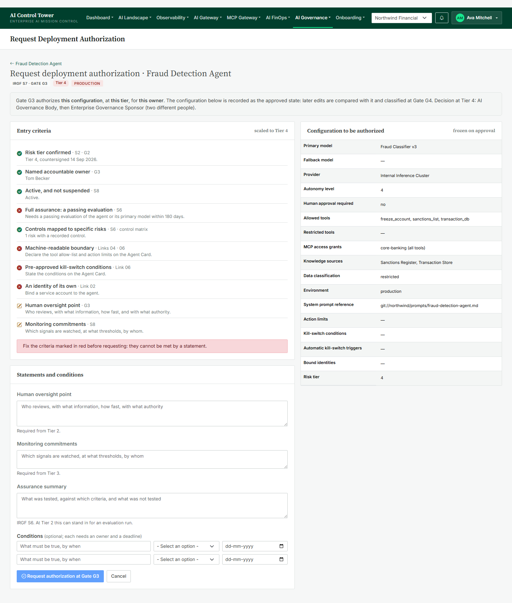

On approval the record freezes the **authorized configuration**:
- models and provider
- autonomy and the human-approval flag
- allowed and restricted tools, and MCP grants
- knowledge sources and data classification
- environment and the system prompt reference
- action limits and kill-switch conditions
- bound identities
- tier

The record also keeps:
- the evidence relied on
- the oversight point and the monitoring commitments
- any dissent
- **conditions**, each with an owner and a deadline

An unmet condition does not lapse: past its deadline it escalates daily to whoever signed.

If the agent changes while a request waits, signing is refused, because the configuration signed
must be the one that runs. Re-authorizing supersedes the previous record.

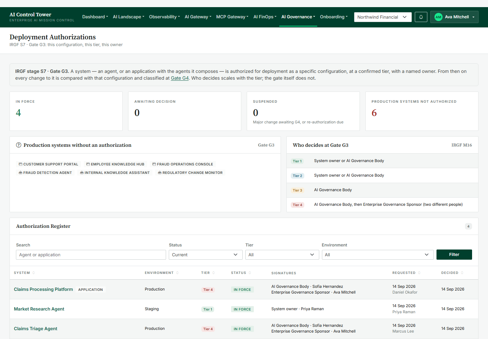

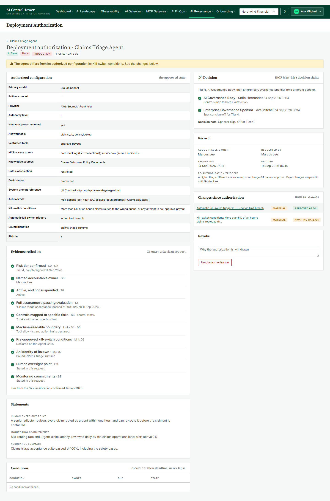

**Enforcing it.** A new policy type, `deployment_authorization`, refuses agents that hold no
authorization in force for the environment they run in. A suspended authorization counts as none.
Its options are `environments`, and `block_pending_changes`, which also refuses material changes
still awaiting G4. A deployment pipeline can check first:
`GET /api/v1/deployment-authorizations/?environment=production` lists each authorization with the
agent's `agent_id` and `in_force`. The `agent` filter takes the agent's platform UUID, not its
`agent_id`. Each agent in the API also carries its `deployment_authorization`.

### Change (S9 · Gate G4)

**What is detected.** Once an agent is authorized, any of these is compared with the authorized
configuration, whether it comes through the web UI, the admin, the API or the platform itself:
- an edit to the agent
- a new or changed MCP grant
- an identity bound or unbound
- a change of tier

Each difference becomes an **AI Change Record**, classified with IRGF's change table:

| Change | Class | Route |
|---|---|---|
| Model version, same provider and family | Minor at Tier 1–2; material at Tier 3–4 | Recorded; G4 at Tier 3–4 |
| New model family or provider | Major | S2 re-score, G2, then G4 |
| Autonomy increased, human approval removed, action limits raised | Major | S2 re-score, G2, then G4 |
| Tool or permission added | Material at Tier 1–2; major at Tier 3–4 | G4 |
| Grounding source added or data more sensitive; prompt changed; kill-switch conditions or identities changed | Material | G4 |
| Environment changed; tier raised | Major | A new G3 authorization |
| Anything that only narrows the boundary | Minor | Recorded |

**What each class does:**
- **Minor:** recorded and accepted. The authorized configuration moves with it.
- **Material:** waits for Gate G4; the authorization stays in force.
- **Major:** waits for G4 with the authorization **suspended**.
- **Rejected at G4:** the authorization stays suspended until the change is reverted.
- **Reverted:** reverting the agent closes the record and restores the authorization.

**Approving a change** needs a **delta assurance scope**: what was re-run, what was not, and why. A
change that re-enters S2 needs a tier scored and countersigned after it happened. A person may lower
a change's class, for example a prompt edit that only fixes wording, with a reason. At Tier 3–4 a
second person must confirm the lower class. IRGF fixes some classes, such as autonomy increases,
and those cannot be lowered.

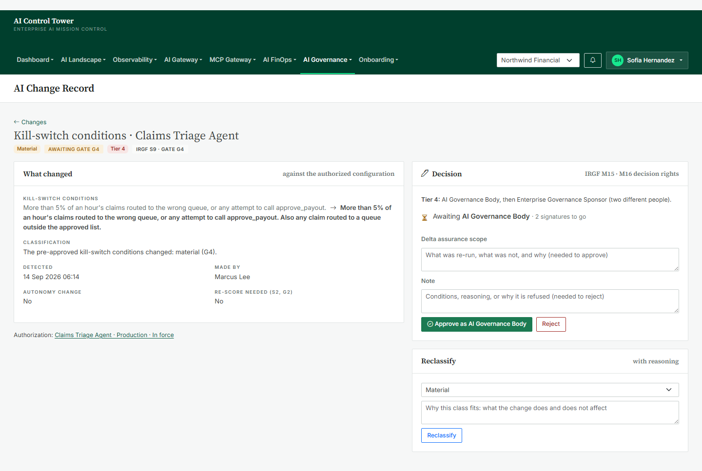

### Exceptions (M17)

- **What it does:** an exception sets **one policy aside for one agent**.
- **What it records:** a justification, a compensating control (required at Tier 3–4) and a hard
  expiry of at most **90 days** at every tier.
- **Renewal:** Tier 4 exceptions cannot be renewed; the agent goes back through G3.
- **Where it applies:** while active, the policy engine skips the excepted policy for that agent only.
  The policy check's response lists it under `excepted`, and the MCP catalog honours it too.
- **Expiry:** an hourly job expires exceptions and warns seven days before they lapse, telling the
  approvers as well as the requester.

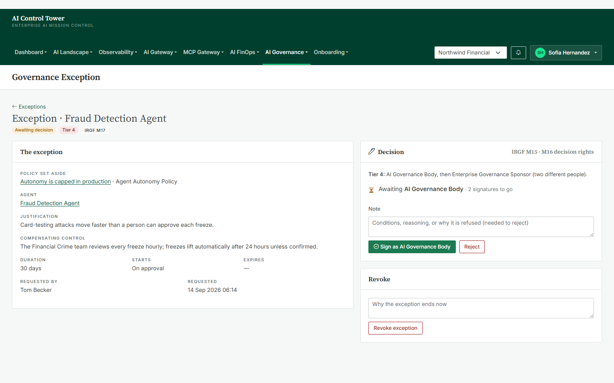

### In the demo

`seed_demo` creates:
- the **Customer Support Agent** authorized by its owner at Tier 2, with a condition due in 45 days
- the **Claims Triage Agent** authorized at Tier 4 with two signatures, the governance manager's and
  then the organization administrator's, on the strength of a passing acceptance run
- the **Market Research Agent** self-certified in staging at Tier 1
- a material change to the claims agent's kill-switch conditions, waiting at G4
- a Tier 4 exception for the fraud agent from *Autonomy is capped in production*, waiting for its two
  signatures

To complete a Tier 4 decision in the demo, sign first as Sofia Hernandez (AI Governance Body), then
as Ava Mitchell (Enterprise Governance Sponsor). Ava is the only administrator, so she signs second.

## 11. Phase 3: the Control Plane

Phase 3 adds IRGF's runtime half. The **Control Plane** (M12) compares what each agent actually does
with the configuration Gate G3 authorized. Each divergence is a **drift record** (M13), routed and
timed by category and tier. **Action limits** are enforced before every tool call (link 06), and
**every action is verified** after it happens, within a ceiling set per tier (link 07). Under *AI
Governance* it adds **Control Plane · M12** and **Drift · M13**, and each agent's page gets a Control
Plane panel.


### What is compared (M12)

| Observed | Compared with | Drift it can raise |
|---|---|---|
| Every MCP tool call the gateway records | The tool allow-list and MCP grants, restricted tools, bound identities, the data classification behind the tool, where it ran | Security (an incident), data lineage, structural |
| Every run an engine reports or the AI Gateway serves | Where it ran, the model that served it, the identity it acted under, the tools it reports calling | Structural, configuration, security |
| Evaluation runs finished after authorization | The pass the authorization relied on | AI-model behavioral |
| Policies whose *effect* changed after authorization (rewording does not count) | The policies in force at Gate G3 | Policy and regulatory |
| Budget alerts at 100% for an agent or application | The approved budget | Cost |
| Tools changed after review that an authorized agent depends on | The definition that was reviewed | Integration and dependency |

Running in production with no authorization is structural drift. Running in staging with no
authorization is testing, and is not drift. The comparison is always with the **authorized**
configuration, not the registry: an edit to the registry is a change for Gate G4 (Phase 2); running
differently from both is drift.

### Drift records (M13)

- **One record per divergence.** A recurrence adds to it, with the latest 20 pieces of evidence
  (tool calls, runs, evaluation runs, policies, budget alerts).
- **Incidents.** An agent crossing its boundary is an incident at any tier: a tool outside its
  allow-list and grants, a restricted tool, or an action over its limits.
- **Response windows** follow IRGF chapter 19:

| Drift | Tier 1 | Tier 2 | Tier 3 | Tier 4 |
|---|---|---|---|---|
| Structural, configuration, integration, cost | Daily digest to the owner | Direct to the owner | Direct, 5 working days | Direct, same business day |
| Security, data lineage | Direct to the owner | Direct, 10 working days | Direct, 5 working days | Immediate, same business day |
| AI-model behavioral | Periodic review | Direct to the owner | Direct; flags an S2 re-score | Direct; S2 re-score, possibly Gate G4 |
| Policy and regulatory | Batch review | Batch review | Direct; re-run the compliance assurance | Immediate compliance review |
| Agent boundary divergence | Immediate, same business day, at every tier | | | |

Working days skip weekends, and a window closes at 18:00. A missed window escalates to the AI Governance
Body. Digest and review routes tell nobody at once: those records collect into a daily digest. A
system with no S2 classification is triaged as Tier 3 until it has one; that default is the
platform's, not IRGF's.

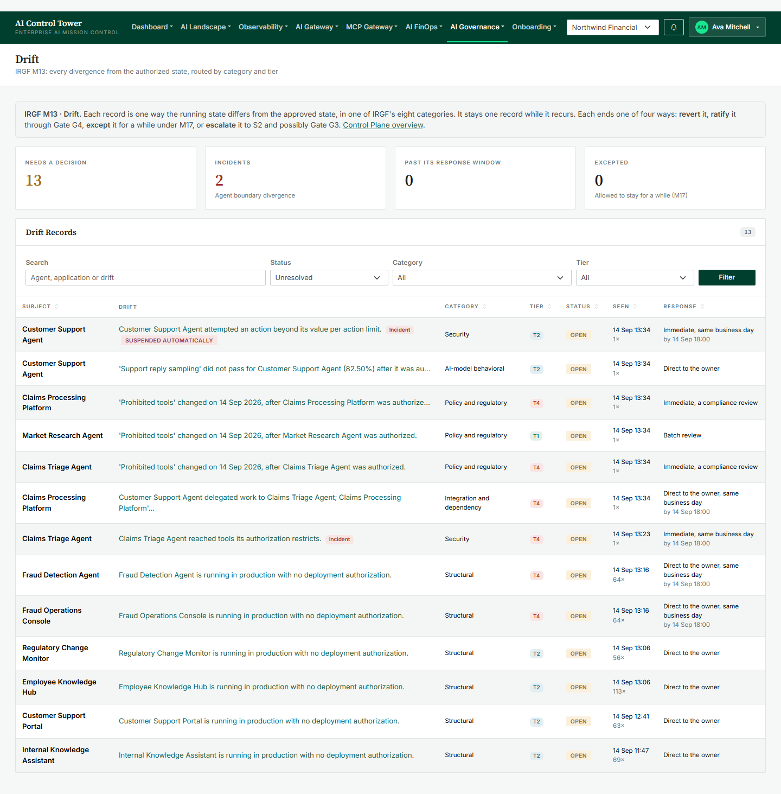

### Four ways a record ends

| Resolution | When | What happens | Who |
|---|---|---|---|
| **Revert** | The divergence was not meant; the approved state is still right | The record closes. If it recurs, a new record opens, linked to this one | System owner, risk function or AI Governance Body |
| **Ratify** | The divergence is an improvement | Record the new state on the agent. The edit becomes a change record, and the drift record closes when Gate G4 approves it (it reopens if G4 refuses). Running without authorization is ratified at Gate G3 and closes once an authorization is in force. Behavioral, policy, cost and integration drift are ratified with a reasoned note | The same |
| **Except** | The divergence must persist for now | An M17 exception for the divergence itself, with the same decision rights and the same 90-day limit. The record shows as excepted while the exception is active, and reopens when it ends | Risk function or AI Governance Body |
| **Escalate** | The tier or the approval was wrong | The S2 classification is flagged for a re-score. Optionally, the deployment authorization is suspended until the agent is authorized again at G3 | Risk function or AI Governance Body |

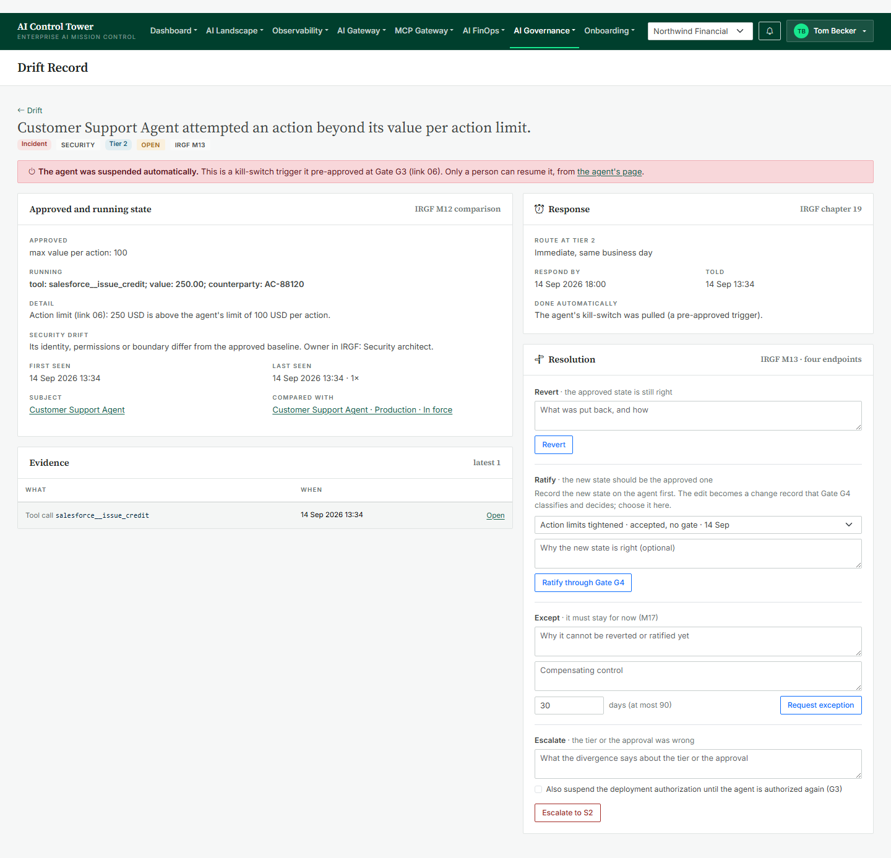

### Action limits (link 06)

- **Which argument carries what.** A tool reviewer marks which argument carries a call's value and
  which names its counterparty. This is set on the MCP server's page, under *Action-limit
  arguments*.
- **Checked before the call.** The MCP Gateway checks the value per action, the day's total, the
  hourly rate (calls that reached a tool) and the allowed counterparties. A call over a limit is
  refused (`blocked`, *Action limit (link 06): …*), never sent. The attempt is recorded, and it is an
  incident.
- **Automatic kill-switch triggers.** The Agent Card lists the kill-switch conditions a machine can
  evaluate: `action_limit_breach`, `boundary_divergence` and `unbound_identity`. They are part of the
  authorized configuration, so changing them is a material change at Gate G4.
  - When one fires, the Control Plane pulls the kill-switch, and only a person can resume the agent.
    This is the only correction the Control Plane automates: IRGF prohibits automated corrective
    enforcement at Tier 3–4, apart from pre-approved kill-switch conditions.
  - The stricter of the registry and the authorized configuration applies. A trigger added since
    Gate G3 already protects, and a trigger removed since G3 keeps protecting until G4 approves the
    removal.
- **A new Gate G3 criterion.** At Tier 3–4 at least one kill-switch trigger must be automatic.

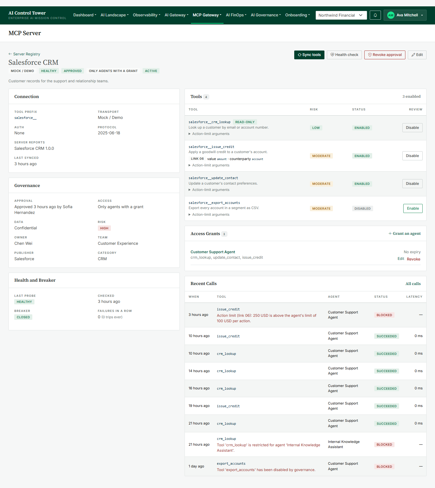

### Verification (link 07)

- **Tool calls** are verified as the MCP Gateway records them, after the record is committed.
- **Runs** are verified by the Control Plane sweep, which runs every minute. A run is left 30 seconds
  after its last update, so events still arriving are part of what is checked. The sweep also catches
  anything the post-save hook missed, looking back seven days.
- **Reported tool calls count too.** For engines that call tools directly and only report the run,
  checking the tools the run reports is the only control there is.
- **Latency and ceilings.** Latency runs from when the platform records an action to its verification.
  IRGF asks for a ceiling per tier without setting values. The platform's defaults are 24 hours at
  Tier 1, 1 hour at Tier 2, 15 minutes at Tier 3 and 5 minutes at Tier 4. Change them with
  `CONTROL_PLANE["VERIFICATION_CEILING_SECONDS"]`. A verification after its ceiling is marked late,
  and the agent's governance chain shows link 07 as a gap.

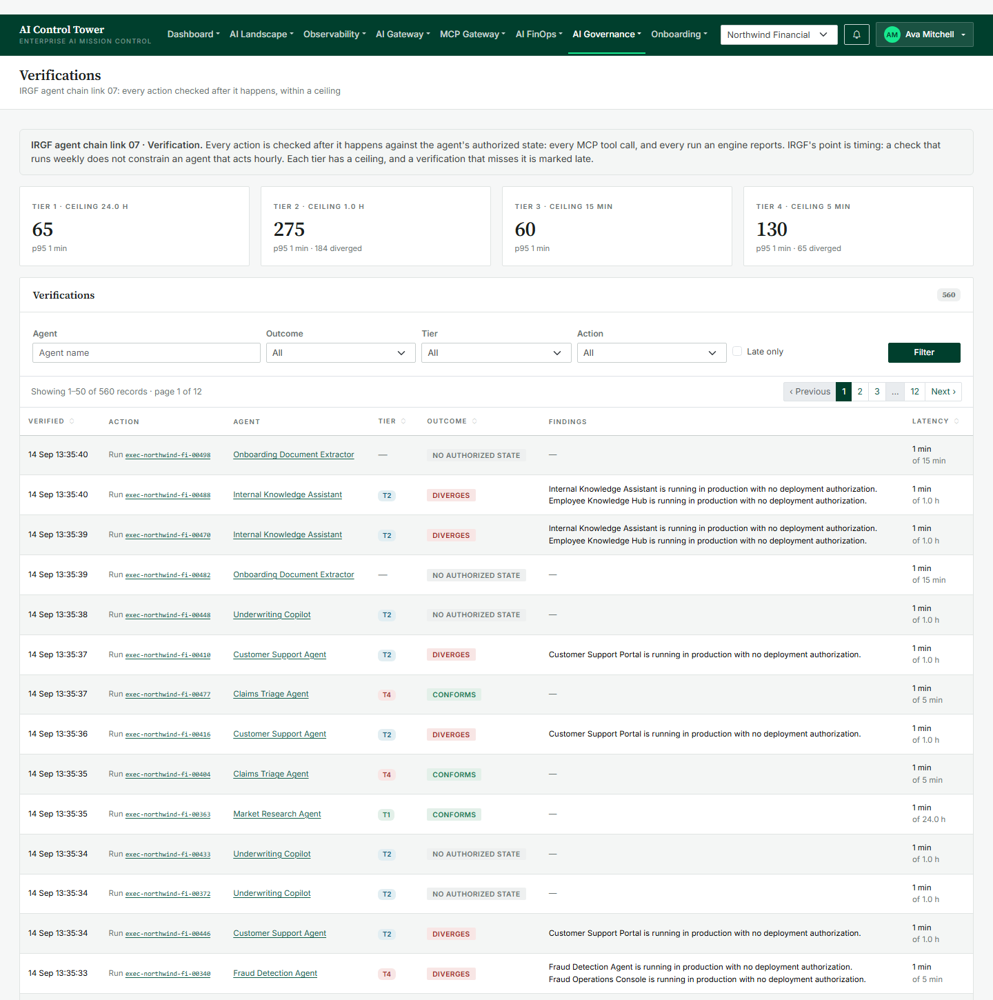

### API, jobs and notifications

- `GET /api/v1/drift-records/` lists drift for incident tooling; resolving stays in the Control Tower.
- The `control-plane-sweep` job runs every minute.
- Drift notifications go to the owner and to holders of `risk.manage`. Incidents and immediate routes
  also go to the AI Governance Body (`gate.decide`), and so does every escalation.

### What Phase 3 leaves out

- **Applications at Gate G3.** Added in Phase 4 ([section 12](#12-phase-4-applications-and-composite-authority)).
- **Calendars.** There is no holiday calendar, and business hours are fixed.
- **Grounding sources at runtime.** Engines do not report them, so data lineage drift comes from
  the classification of the MCP servers an agent reaches.
- **Currencies.** Values in another currency are not converted before they are compared with a
  limit.

### In the demo

`seed_demo` runs the Control Plane over everything it seeds. On top of what it finds by itself, it
stages:
- the **Customer Support Agent** trying a 250 USD goodwill credit against its 100 USD limit. The
  gateway refuses it before it reaches Salesforce, the agent's pre-approved trigger suspends it, and
  Chen Wei resumes it after checking. The incident stays open for a decision.
- the **Claims Triage Agent**'s engine reporting a run that called `approve_payout`, a tool its
  authorization restricts: a Tier 4 incident, due the same business day
- the support agent's weekly **sampling suite** scoring 82.5% after authorization: behavioral drift,
  sent to its owner
- **bulk export added to the prohibited tools** after the authorizations: policy drift, ratified for
  the support agent with a note, waiting for batch review for the Tier 1 research agent, and an
  immediate compliance review for the Tier 4 claims agent

The Control Plane also finds, by itself, the **Fraud Detection Agent**, the **Internal Knowledge
Assistant** and the **Regulatory Change Monitor** running in production with no authorization. The
Tier 4 fraud agent's record is due the same business day and escalates once that window closes.

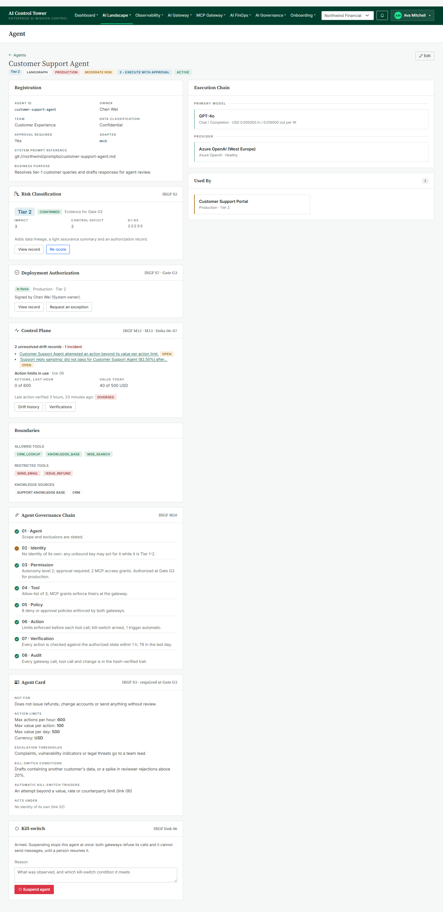

## 12. Phase 4: applications and composite authority

Phase 4 authorizes **applications** at Gate G3, not only agents. IRGF authorizes a *system*, and an
application is a system of several parts: models, providers and agents. For a system of several
agents, IRGF chapter 16 asks for two things:
- the **composite reachable authority**, meaning what can be reached through all of its agents, with
  D2 and D3 scored against that composite rather than against whichever agent is the entry point
- an explicit **delegation graph**: which agents may invoke which, and with whose authority

### What an application's authorization records

- its models and providers
- its member agents
- **its delegation graph.** Each edge is `{"from": agent_id, "to": agent_id, "authority": "own" | "caller"}`.
  An edge with `caller` authority means the invoked agent acts with its caller's authority, which is
  where authority compounds. The graph is declared on the application's edit page or over the API; it
  is not inferred from traffic.
- **its composite reachable authority:**
  - the highest autonomy level among its agents
  - which acting agents need no human approval
  - every tool reachable through their allow-lists and MCP grants
- its tools, data classification, environment and tier

Each acting agent keeps its own authorization; the application's covers the whole.

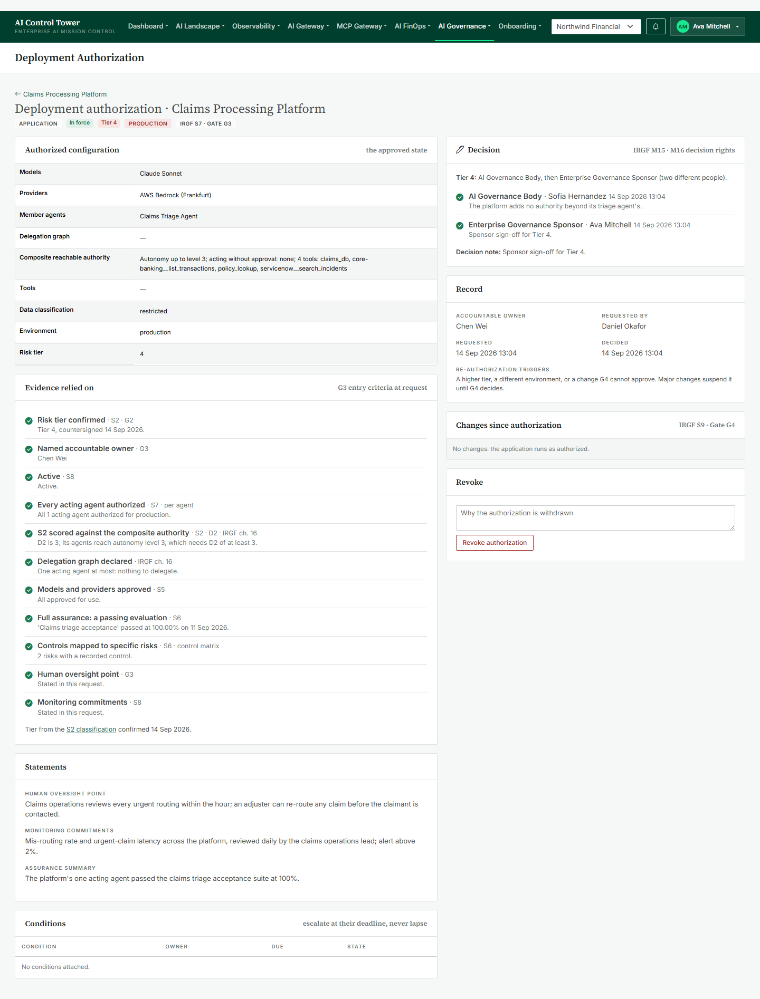

### Entry criteria for an application

| Entry criterion | IRGF | Required from |
|---|---|---|
| Tier confirmed | S2 · G2 | Tier 1 |
| A named accountable owner (the business owner, or else the technical owner) | G3 | Tier 1 |
| Every acting member agent authorized for the application's environment | S7, per agent | Tier 1, when an agent acts |
| S2 scored against the composite: the application's D2 at least what its most autonomous agent implies | S2 · D2 · chapter 16 | Tier 1 |
| A delegation graph declared, naming member agents only | Chapter 16 | Tier 3 with more than one acting agent. An edge naming a non-member blocks at any tier |
| Models and providers approved | S5 | Tier 1 |
| Assurance: an evaluation of a member agent or model, or a written summary | S6 | Tier 2. From Tier 3, a passing evaluation within 180 days |
| Controls mapped to risks of the application or its agents | S6 | Tier 3 |
| A human oversight point, and monitoring commitments | G3 · S8 | Tier 2 and Tier 3 |

Decision rights are the same as for agents. The system owner seat belongs to the application's
business owner.

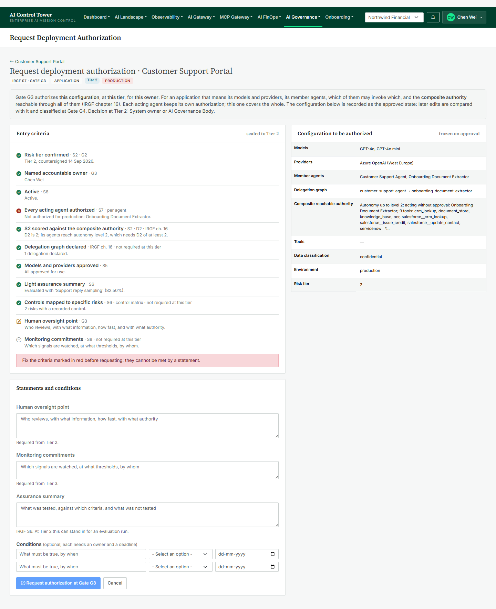

### Change (G4) for applications

| Change | Class |
|---|---|
| A model of the same provider and family added | Minor at Tier 1–2; material at Tier 3–4 |
| A model of a new family, or a new provider | Major |
| An agent added to the application | Material at Tier 1–2; major at Tier 3–4 |
| A delegation added | Material at Tier 1–2; major at Tier 3–4 |
| A member agent's authority widened: a tool, more autonomy, human approval removed | As for an agent (tool, autonomy or oversight change) |
| A different environment, or a higher tier | A new G3 authorization |
| Anything removed | Minor |

An edit to a member agent is compared with the agent's own authorization, and with every application
the agent belongs to.

### At runtime

- **Application runs.** A run that names an application is also checked against that application's
  authorized configuration. Running in production without an authorization is structural drift, and
  so is running an agent outside the authorized membership. A model outside it is configuration
  drift.
- **Delegation.** Every agent-to-agent message through the gateway is a delegation. The Control Plane
  checks it against the declared graphs of the authorized applications that either agent belongs
  to.
  - A path none of those graphs declares is integration drift, recorded against each of those
    applications.
  - Messages are verified like tool calls (link 07), and they are listed under *Verifications*.
- **Policy.** The `deployment_authorization` policy holds an application to its own authorization
  whenever a check names one: the policy check API, or telemetry that names the application.

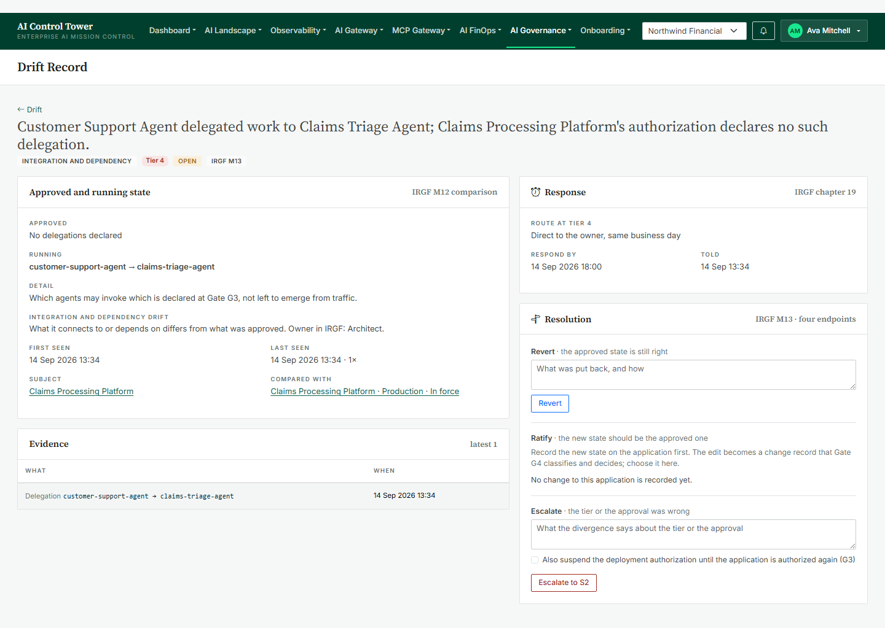

### What Phase 4 leaves out

- **Exceptions.** M17 exceptions are still granted to agents, not to applications.
- **Caller authority at runtime.** A `caller` delegation is recorded, and it counts in the composite.
  At runtime, though, each agent is still held to its own boundary: an invoked agent that uses its
  caller's tools shows as boundary divergence of its own.
- **AI Gateway calls.** The gateway's model calls do not name an application, so the application
  check applies only where a caller or telemetry names one.

### In the demo

- **Claims Processing Platform** is authorized at Tier 4, by the AI Governance Body and then the
  Enterprise Governance Sponsor. Its one acting agent is authorized, and its D2 matches that agent's
  autonomy.
- **Customer Support Portal** declares that its support agent hands documents to the Onboarding
  Document Extractor. The portal cannot be authorized yet: the extractor runs in development and
  holds no authorization for production. Its request page shows that.
- **An undeclared delegation.** The support agent asks the claims agent about a claim, through the
  gateway. The Claims Processing Platform declares no such delegation, so the Control Plane records
  integration drift against it.
- **Unauthorized applications.** Production runs of the Fraud Operations Console, the Employee
  Knowledge Hub and the Customer Support Portal are structural drift, because none of the three
  holds an authorization.


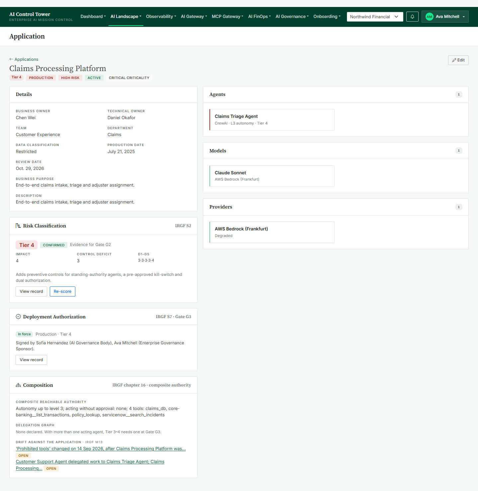

## 13. Mapping and roadmap

| IRGF element | Status |
|---|---|
| S2 · M4 dimensions · M5 tiering · M6 countersignature | **Phase 1** |
| Tier driving controls; independent approval decisions at Tier 3–4 | **Phase 1** |
| M15 · M16 decision bodies, decision rights and Tier 4 dual authorization | **Phase 2** |
| Agent chain 01 Agent, 03 Permission, 05 Policy, 08 Audit | Existing, now shown per agent |
| Agent chain 02 Identity | **Phase 1** |
| Agent chain 04 Tool | Existing: MCP grants are enforced allow-lists. **Phase 3**: every tool reached is verified against the allow-list and grants |
| Agent chain 06 Action: kill-switch and declared limits | **Phase 1**; limits enforced before each tool call, and automatic kill-switch triggers: **Phase 3** |
| Agent Card (S3, required at G3) | **Phase 1** |
| S7 · G3 Deployment Authorization Record, conditions, and traffic only for authorized agents | **Phase 2** |
| S9 · G4 AI Change Record, classified automatically, with delta assurance scope | **Phase 2** |
| M17 time-boxed exceptions | **Phase 2** |
| M12 Control Plane: compare *running* state (what executions and tool calls actually used) with the authorized state | **Phase 3** |
| M13 drift records: eight categories, tier-based response times, Revert / Ratify / Except / Escalate | **Phase 3** |
| Agent chain 07 Verification: post-action checks within a latency ceiling | **Phase 3** |
| Authorizing applications, not only agents: models, providers, member agents | **Phase 4** |
| Chapter 16: composite reachable authority, D2 scored against it, a declared delegation graph | **Phase 4** |
| Delegation at runtime: agent-to-agent messages checked against the declared graphs | **Phase 4** |
| Caller-authority delegations widening an invoked agent's boundary at runtime | Next |
| M17 exceptions for applications | Next |
| Design-time records (Use-Case Canvas, ADRs, pattern library, benefit and capability records) | Kept in architecture tooling; applications link to them |
