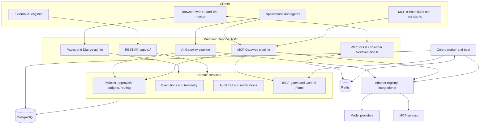
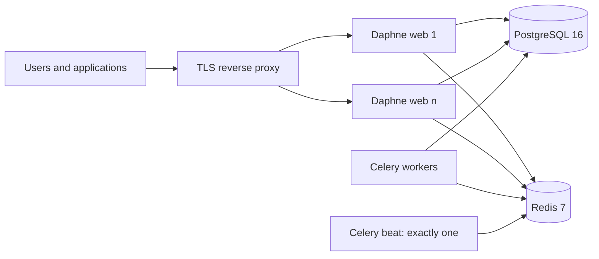
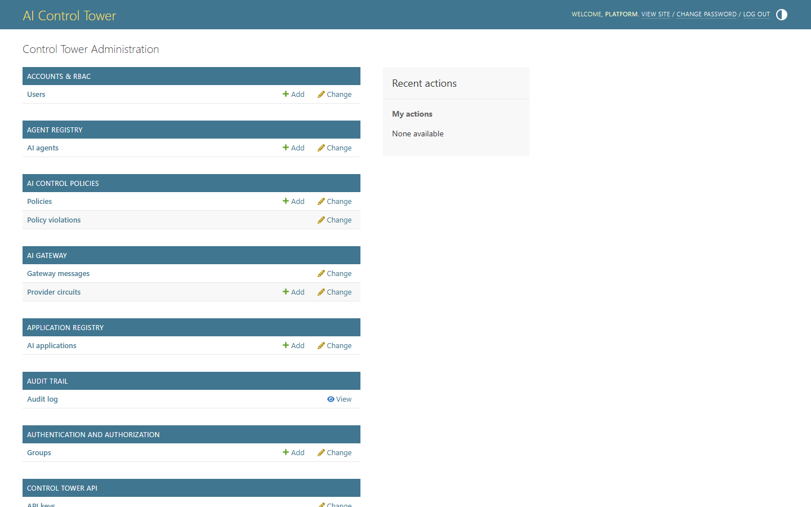
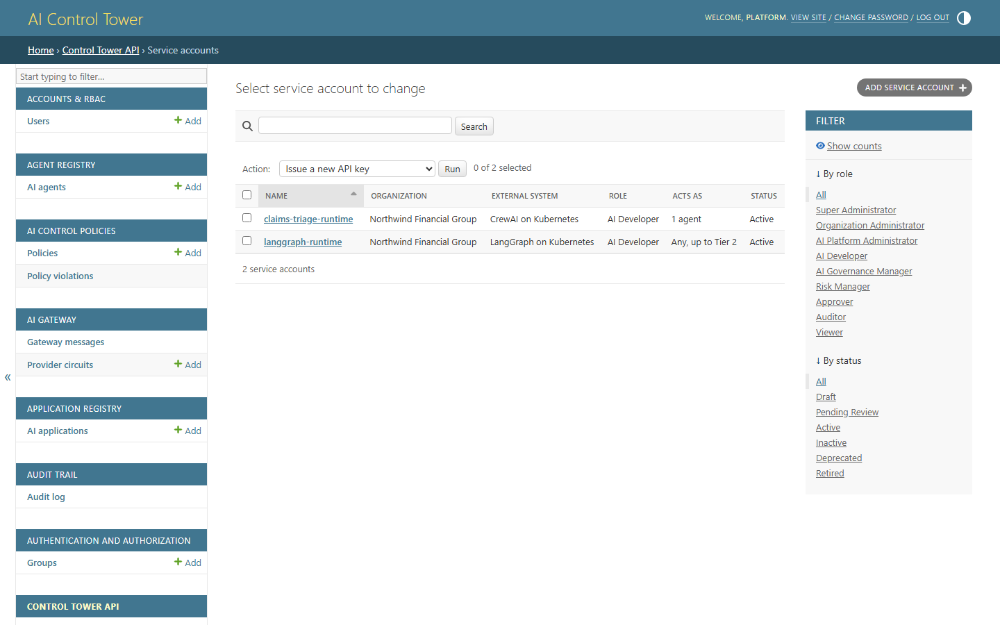
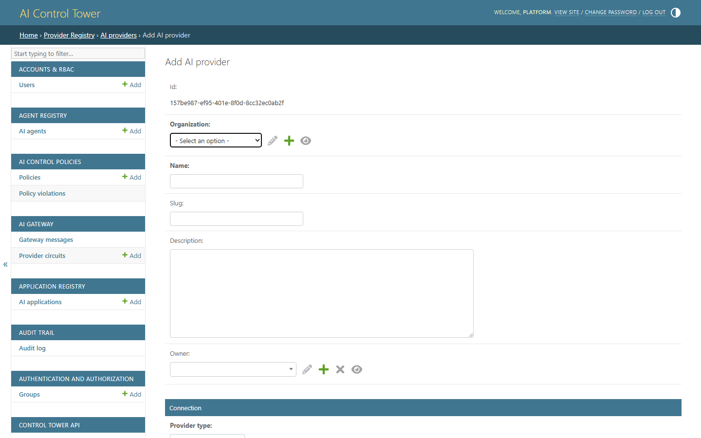
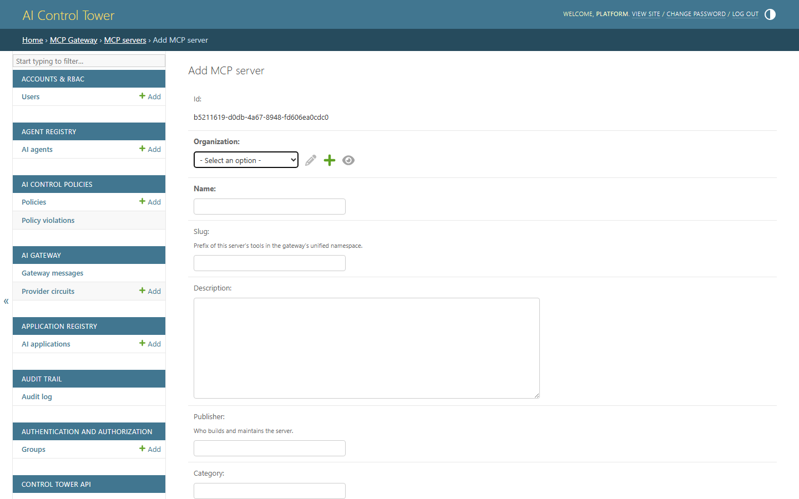

# AI Control Tower Technical Guide

The technical reference for installing, configuring, integrating and operating AI Control Tower.

| | |
|---|---|
| **Audience** | Platform engineers who install and run the platform; developers who connect applications, agents and engines to it |
| **Covers** | Architecture, installation, first-run setup, every configuration setting, the integration contracts of the REST API and both gateways, governance internals, security, operations, troubleshooting and FAQs |
| **Applies to** | This repository: Python 3.12, Django 6.1, Django REST Framework 3.18, Channels 4.3, Celery 5.6 |

Related documents:

- [README](../README.md) — product overview and a tour of every screen.
- [SETUP.md](../SETUP.md) — step-by-step installation walkthroughs with screenshots.
- [IRGF alignment](irgf-alignment.md) — how the platform applies the Intent-to-Runtime Governance
  Framework: risk tiers, the deployment and change gates, the Control Plane and applications as
  systems of agents.
- **Integration Handbook** — `/docs/integration/` in a running instance, with sample code for Python,
  TypeScript and common agent frameworks.

## Contents

1. [Architecture](#1-architecture)
2. [Installation](#2-installation)
3. [Initial setup](#3-initial-setup)
4. [Configuration reference](#4-configuration-reference)
   - [4.1 How settings are loaded](#41-how-settings-are-loaded) ·
     [4.2 Core](#42-core) ·
     [4.3 Database, cache, queues and WebSockets](#43-database-cache-queues-and-websockets) ·
     [4.4 Email](#44-email) ·
     [4.5 AI Gateway](#45-ai-gateway) ·
     [4.6 MCP Gateway](#46-mcp-gateway) ·
     [4.7 Content display](#47-content-display) ·
     [4.8 Settings that live in code](#48-settings-that-live-in-code) ·
     [4.9 Credentials](#49-credentials) ·
     [4.10 Provider and MCP server options](#410-provider-and-mcp-server-options) ·
     [4.11 Example environment files](#411-example-environment-files)
5. [Integrations](#5-integrations)
   - [5.1 Choosing an integration pattern](#51-choosing-an-integration-pattern) ·
     [5.2 Authentication](#52-authentication) ·
     [5.3 API conventions](#53-api-conventions) ·
     [5.4 Endpoint reference](#54-endpoint-reference) ·
     [5.5 Registry API](#55-registry-api) ·
     [5.6 Telemetry API](#56-telemetry-api) ·
     [5.7 Telemetry webhook](#57-telemetry-webhook) ·
     [5.8 Policy check API](#58-policy-check-api) ·
     [5.9 Approval requests API](#59-approval-requests-api) ·
     [5.10 AI Gateway](#510-ai-gateway) ·
     [5.11 Agent-to-agent messaging](#511-agent-to-agent-messaging) ·
     [5.12 MCP Gateway](#512-mcp-gateway) ·
     [5.13 Live monitor WebSocket](#513-live-monitor-websocket) ·
     [5.14 Extending with adapters](#514-extending-with-adapters)
6. [Governance internals](#6-governance-internals)
7. [Security](#7-security)
8. [Operations](#8-operations)
9. [Troubleshooting](#9-troubleshooting)
10. [FAQ](#10-faq)
11. [Glossary](#11-glossary)

[Appendix A. Code map](#appendix-a-code-map)

---

## 1. Architecture

### 1.1 What the platform does

AI Control Tower gives an organization one control plane for its AI estate:

- **Registry.** Every platform provider, model, agent, application and MCP server, with owners,
  lifecycle status, data classification, risk, pricing and health.
- **Observability.** Every run — an *execution* — with a normalized event timeline, tokens, cost and
  latency, whether an external engine reported it or a gateway served it.
- **Governance.** Control policies, approval rules and requests, budgets, a risk register,
  evaluation suites and a hash-verified audit trail. On top of them runs the IRGF lifecycle:
  - a risk tier for every system (S2)
  - deployment authorization (Gate G3) and change control (Gate G4)
  - time-boxed exceptions (M17)
  - a Control Plane that compares what runs with what was authorized (M12–M13)
- **Enforcement.** Two gateways in the request path — the **AI Gateway** for model calls and the
  **MCP Gateway** for tool calls — that turn governance into real refusals and hold the upstream
  credentials, so applications never do.

Each application chooses how closely it integrates. The two modes run side by side:

| | Reporting mode | Gateway mode |
|---|---|---|
| How the application reaches AI | Directly, with its own provider and tool credentials | Through `/api/v1/gateway/chat/` and `/api/v1/mcp/` |
| What it sends the Tower | Telemetry: runs and their events | The calls themselves |
| Policy | Advisory: ask `/api/v1/policy/check/` and act on the answer | Enforced: `deny` refuses, `require_approval` holds |
| Budgets | Alerts | Alerts, and hard stops where configured |
| Credentials | Held by the application | Held by the platform; the application holds only its API key |
| Routing and fallback | The application's own | Cost-, latency- or reliability-aware, with circuit breakers |


### 1.2 Technology stack

| Layer | Technology | Notes |
|---|---|---|
| Language | Python 3.12 | The Docker image is `python:3.12-slim` |
| Web framework | Django 6.1.1 | Server-rendered UI; Django admin at `/admin/` |
| API | Django REST Framework 3.18.1, django-filter 26.1 | Under `/api/v1/`; the browsable API is enabled |
| ASGI and WebSockets | Channels 4.3.2 with Daphne; channels-redis 4.3.0 | Serves the live execution monitor |
| Background work | Celery 5.6.3 with Redis 7 (redis-py 8.1.0) | Schedule in `aig_tower/celery.py` |
| Database | PostgreSQL 16 through psycopg 3.3.5; SQLite for local use | All durable state, circuit-breaker state included |
| Static files | WhiteNoise 6.12.0 | Compressed and fingerprinted with `USE_MANIFEST_STATIC=1` |
| Front end | Bootstrap 5, Bootstrap Icons, jQuery, Chart.js, Google Fonts | Loaded from public CDNs; no build step |
| Configuration | python-dotenv 1.2.3 | Reads `.env` from the project root |

`gunicorn` is listed in `requirements.txt`, but it is a WSGI server and cannot serve WebSockets.
Serve the platform with Daphne.

### 1.3 Components



One Django project, `aig_tower`, serves the pages, the admin, the REST API and the WebSockets from
one ASGI process. Celery runs the scheduled jobs and the work the UI queues. PostgreSQL holds all
durable state. Redis carries the Celery broker and results, the cache and the WebSocket channel
layer. With `USE_SQLITE=1` nothing needs Redis: the channel layer is in-memory and the cache is
local memory.

### 1.4 Django apps

| App | Responsibility |
|---|---|
| `apps.core` | Base models, organization-scoped managers, shared constants, `seed_demo` |
| `apps.accounts` | Users, roles and the permission matrix |
| `apps.organizations` | Organizations, teams, memberships, the active-organization middleware |
| `apps.providers` | Platform provider registry and health checks |
| `apps.models_registry` | Model registry, pricing and approvals |
| `apps.agents` | Agent registry |
| `apps.applications_registry` | Application registry |
| `apps.inventory` | The AI Landscape registry pages |
| `apps.executions` | Executions, events, traces and the live monitor consumer |
| `apps.telemetry` | Payload ingestion through execution adapters; raw payload retention |
| `apps.gateway` | AI Gateway pipeline, provider circuit breakers, agent-to-agent messaging |
| `apps.routing` | Routing policies, the routing simulator and routing decisions |
| `apps.mcp_gateway` | MCP server registry, tool discovery and review, access grants, the unified MCP endpoint |
| `apps.costs` | Pricing, spend, rollups, budgets and alerts |
| `apps.risks` | Risk register and heat map |
| `apps.approvals` | Approval rules, approval requests and the Approval Centre |
| `apps.policies` | Control policies and the policy engine |
| `apps.classification` | IRGF S2 risk classification: D1–D5 scores, tiers, M6 countersignature and re-score triggers |
| `apps.lifecycle` | IRGF Gates G3 and G4 and M17 exceptions: deployment authorizations, change records, exceptions and decision rights |
| `apps.controlplane` | IRGF Control Plane (M12): drift records (M13), action-limit checks (link 06) and verification of every action (link 07) |
| `apps.evaluations` | Evaluation suites, cases, scorers and runs |
| `apps.notifications` | In-app and email notifications |
| `apps.audit` | Append-only, hash-verified audit trail |
| `apps.api` | REST API, including both gateways' endpoints |
| `apps.dashboard` | Dashboard, Control Tower and the Integration Handbook |
| `apps.integrations` | Loads the adapter registry at startup |

### 1.5 Request paths

**AI Gateway** — `identity → policy → budget → routing → attempt chain → record`

| Stage | What happens | Refusal |
|---|---|---|
| Identity | The API key resolves to a service account and its organization. The role must hold `gateway.invoke`. The `agent` is resolved. A suspended or retired agent is refused, and so is a Tier 3–4 agent named by a key not bound to it. | 401, 403 (`agent_suspended`, `agent_inactive`, `identity_not_bound`) |
| Policy | The policy engine evaluates the request: agent, its declared model, environment and estimated cost, including any `risk_classification` and `deployment_authorization` policies. Model-dependent policies are checked again against every candidate model the router picks. | 403 `policy_denied`, 202 `approval_required` |
| Budget | A hard-stop budget that is exhausted for the current period refuses the request, unless `GATEWAY_ENFORCE_BUDGETS=0`. | 402 `budget_exceeded` |
| Routing | Builds a ranked chain of eligible models from the routing policy, model status, provider health and breaker state. A pinned `model` goes first. | 503 `no_route` |
| Attempt chain | Calls each candidate in turn, each under `GATEWAY_ATTEMPT_TIMEOUT`, the whole request under `GATEWAY_DEADLINE`. Failures count against the provider's circuit breaker. | 502 `all_attempts_failed` |
| Record | Writes the execution, its cost (priced from the model registry's rates) and the routing outcome. Recording is best-effort: a failure to record never fails a call that was served. The Control Plane sweep later verifies the run against the agent's authorization (IRGF link 07). | — |

**MCP Gateway** — `identity → registry → access → policy → limits → breaker → upstream → record → verify`

| Stage | Checks | Outcome when it fails |
|---|---|---|
| Identity | API key, `mcp.invoke`, the browser `Origin`, the protocol version and the agent | HTTP 401, 403, 400 or 404 |
| Registry | The server is active, approved and reachable over Streamable HTTP; the tool is enabled (not awaiting review, disabled or removed upstream) | `blocked` |
| Access | The agent is active and not suspended; the tool is not on its `restricted_tools`; a restricted server needs an unexpired grant for the agent that covers the tool | `blocked` |
| Policy | The policy engine evaluates the call, with action `mcp.tool_call`, the tool name, the agent and the environment | `blocked`, naming the policies |
| Limits | The agent's action limits (IRGF link 06): the value in the tool's value argument, per call and per day; calls per hour; the counterparty. A refusal is an incident, and fires the agent's `action_limit_breach` trigger if it has one | `blocked` |
| Breaker | The server's circuit is closed, or its cool-off has elapsed and a probe may go through | `unavailable` |
| Upstream | The call goes out under `MCP_GATEWAY_CALL_TIMEOUT`, with the platform injecting the server's credential | `failed`, `tool_error` or `succeeded` |
| Record | A tool-call log entry; arguments and a result preview if `MCP_GATEWAY_RECORD_ARGUMENTS=1`; the call goes onto the caller's execution timeline when the caller names one | — |
| Verify | Once the record commits, the Control Plane checks the call against the agent's authorized configuration (IRGF link 07). A divergence becomes a drift record; the caller's answer is not delayed | — |

**Telemetry ingestion** — an engine posts a run to `/api/v1/executions/`, or a whole payload to
`/api/v1/telemetry/webhook/`. For webhook payloads the raw body is stored first, so a rejected
payload survives for diagnosis. An execution adapter normalizes the payload. The execution is created
or updated by its `execution_id`, loose identifiers are resolved against the registry, and events
are appended. Cost is derived from registry pricing when the run did not report it. Ingestion writes
a `telemetry_ingest` audit entry. Once a run has been quiet for 30 seconds, the Control Plane sweep
verifies it, including the tools it reports calling (IRGF link 07).

### 1.6 Tenancy and access control

- **The organization is the tenant.** Every organization-owned record carries an `organization` and
  is read through organization-scoped managers (`for_organization()`, `for_user()`). API viewsets
  apply this scoping in `get_queryset`, so no endpoint can forget it.
- **People** hold a membership with a role in each organization they belong to. A person in several
  organizations switches between them with the selector in the header. Superusers see every
  organization.
- **Service accounts** belong to exactly one organization and carry a role, like people.
- **Permissions** are checked on every page, action and API call, against the caller's role in the
  organization concerned.

Every role holds the six read permissions: `inventory.view`, `execution.view`, `cost.view`,
`risk.view`, `approval.view` and `policy.view`. Beyond them:

| Permission | Org Admin and Super Admin | Platform Admin | AI Developer | Governance Manager | Risk Manager | Approver | Auditor | Viewer |
|---|:-:|:-:|:-:|:-:|:-:|:-:|:-:|:-:|
| `org.manage`, `user.manage` | ✓ | | | | | | | |
| `inventory.manage` | ✓ | ✓ | ✓ | | | | | |
| `provider.manage`, `model.manage` | ✓ | ✓ | | | | | | |
| `agent.manage`, `application.manage` | ✓ | ✓ | ✓ | | | | | |
| `agent.suspend` (the kill-switch) | ✓ | ✓ | ✓ | ✓ | ✓ | | | |
| `gate.decide` (the AI Governance Body: Tier 3–4 gate decisions) | ✓ | | | ✓ | | | | |
| `gate.sponsor` (the Enterprise Governance Sponsor: Tier 4's second signature) | ✓ | | | | | | | |
| `model.approve` | ✓ | | | ✓ | | | | |
| `telemetry.ingest` | ✓ | ✓ | ✓ | | | | | |
| `prompt.view` | ✓ | ✓ | ✓ | ✓ | ✓ | ✓ | ✓ | |
| `gateway.invoke` | ✓ | ✓ | ✓ | | | | | |
| `mcp.manage` | ✓ | ✓ | | | | | | |
| `mcp.approve` | ✓ | | | ✓ | | | | |
| `mcp.invoke` | ✓ | ✓ | ✓ | | | | | |
| `cost.manage` | ✓ | ✓ | | | | | | |
| `risk.manage` | ✓ | | | ✓ | ✓ | | | |
| `approval.decide` | ✓ | | | ✓ | | ✓ | | |
| `policy.manage` | ✓ | | | ✓ | | | | |
| `audit.view` | ✓ | | | ✓ | ✓ | | ✓ | |

Super Administrator and Organization Administrator hold the same permissions. They differ only in
scope: a super administrator spans organizations.

### 1.7 The adapter layer

Everything vendor-specific lives behind the adapter registry in [`integrations/`](../integrations/),
a plain Python package that imports without Django, so adapters can be unit-tested and reused
outside the platform.

- **Contracts** are in `integrations/base/`. Each adapter kind has a base class.
- **The registry** (`integrations/registry.py`) maps a kind and a key to a class. Application code
  asks for an adapter by key and never branches on vendor names.
- **Discovery** (`integrations/bootstrap.py`) imports each module listed in `ADAPTER_MODULES` when
  the platform starts. A module that fails to import is logged and skipped; the rest of the platform
  still starts.

| Kind | Built-in key | What it does |
|---|---|---|
| provider | `openai` | The OpenAI API, or any OpenAI-compatible endpoint set as the provider's `endpoint`. Needs `pip install openai`, which is not in `requirements.txt`. |
| provider | `generic_rest` | Any JSON-over-HTTP inference service, described by the provider's `options` |
| provider | `mock` | Deterministic answers with no credentials, for demos and tests |
| agent | — | A mock agent engine in `integrations/agents/mock.py` |
| execution | `generic_webhook` | Normalizes engine payloads posted to `/api/v1/telemetry/webhook/` |
| mcp | `streamable_http` | The MCP Streamable HTTP transport |
| mcp | `mock` | An in-process MCP server for demos and tests |

The `tool`, `observability` and `cost` kinds have contracts but no built-in adapters.
`GET /api/v1/adapters/` lists what the running installation has loaded ([5.14](#514-extending-with-adapters)).

An adapter instance receives an `AdapterConfig` holding `key`, `name`, `endpoint`, `region`,
`deployment`, `credential_ref`, `timeout` (default 30 seconds) and free-form `options`. It never
receives a secret: `resolve_credential()` reads the environment variable named by `credential_ref`
at the moment of the call.

Adapters advertise capabilities from a fixed vocabulary: `supports_chat`, `supports_streaming`,
`supports_embeddings`, `supports_vision`, `supports_tool_calling`, `supports_structured_output`,
`supports_reasoning`, `supports_audio`, `supports_image_generation`, `supports_usage_metrics`,
`supports_native_agents`, `supports_cost_reporting` and `supports_health_check`.

---

## 2. Installation

[SETUP.md](../SETUP.md) walks through each option with screenshots. This section is the condensed
reference.

### 2.1 Requirements

| Component | Version | Needed for |
|---|---|---|
| Python | 3.12 | Every install except Docker |
| Git | any recent | Getting the code |
| PostgreSQL | 16 | Shared and production installs |
| Redis | 7 | Celery, the cache and the WebSocket channel layer, whenever `USE_SQLITE=0` |
| Docker with Compose v2 | recent | The Docker install |

| Port | Used by |
|---|---|
| 8000 | The web server (UI, API, gateways, WebSockets) |
| 5432 | PostgreSQL |
| 6379 | Redis |

Browsers load Bootstrap, Bootstrap Icons, jQuery, Chart.js and Google Fonts from
`cdn.jsdelivr.net` and `fonts.googleapis.com`. The browser needs to reach them, not the server. For
an air-gapped network, copy the assets into `static/` and point `templates/base.html` at the copies.

### 2.2 Local install with SQLite

No database server, no Redis, no Docker.

```bash
git clone <your-repository-url> aig-tower
cd aig-tower
python -m venv .venv
```

```powershell
# Windows (PowerShell). If script execution is blocked, use .venv\Scripts\activate.bat from cmd.
.venv\Scripts\Activate.ps1
```

```bash
# macOS / Linux
source .venv/bin/activate
```

```bash
python -m pip install --upgrade pip
pip install -r requirements.txt
```

Create `.env` in the project root:

```dotenv
DJANGO_DEBUG=1
USE_SQLITE=1
CELERY_TASK_ALWAYS_EAGER=1
```

```bash
python manage.py migrate
python manage.py seed_demo
python manage.py runserver 8000
```

Open <http://localhost:8000>. `runserver` serves the ASGI application through Daphne (it is listed
ahead of `staticfiles` in `INSTALLED_APPS`), so the live monitor's WebSockets work without a
separate process.

### 2.3 Local install with PostgreSQL and Redis

```bash
psql -U postgres -c "CREATE ROLE aig_tower WITH LOGIN PASSWORD 'aig_tower';"
psql -U postgres -c "CREATE DATABASE aig_tower OWNER aig_tower;"
docker run -d --name aig-redis -p 6379:6379 redis:7-alpine
```

`.env`:

```dotenv
DJANGO_DEBUG=1
USE_SQLITE=0
POSTGRES_DB=aig_tower
POSTGRES_USER=aig_tower
POSTGRES_PASSWORD=aig_tower
POSTGRES_HOST=localhost
POSTGRES_PORT=5432
REDIS_URL=redis://localhost:6379/0
CELERY_BROKER_URL=redis://localhost:6379/1
CELERY_RESULT_BACKEND=redis://localhost:6379/2
CHANNEL_LAYER_URL=redis://localhost:6379/3
```

```bash
python manage.py migrate
python manage.py seed_demo
python manage.py runserver 8000
```

Then, in two more terminals (add `--pool=solo` to the worker on Windows):

```bash
celery -A aig_tower worker --loglevel=info
```

```bash
celery -A aig_tower beat --loglevel=info
```

### 2.4 Docker Compose

```bash
cp .env.example .env
docker compose up --build -d
docker compose exec web python manage.py seed_demo
docker compose exec web python manage.py createsuperuser
```

On PowerShell, copy the file with `Copy-Item .env.example .env`. Before starting, set
`DJANGO_SECRET_KEY` in `.env`, and any provider keys you want to use.

| Service | Image or command | Host port | Notes |
|---|---|---|---|
| `postgres` | `postgres:16-alpine` | 5432 | Data in the `postgres_data` volume; health-checked with `pg_isready` |
| `redis` | `redis:7-alpine` | 6379 | Health-checked with `redis-cli ping` |
| `web` | `migrate`, `collectstatic`, then `daphne -b 0.0.0.0 -p 8000 aig_tower.asgi:application` | 8000 | Sets `USE_SQLITE=0` and `USE_MANIFEST_STATIC=1` |
| `celery_worker` | `celery -A aig_tower worker --loglevel=info` | — | |
| `celery_beat` | `celery -A aig_tower beat --loglevel=info` | — | |

Every application service reads `.env` and overrides the database and Redis hosts with the Compose
service names. Each concern uses its own Redis database: 0 for the cache, 1 for the Celery broker, 2
for Celery results and 3 for the channel layer.

The Compose file is a development stack. It bind-mounts the source into `/app` (Daphne does not
auto-reload, so run `docker compose restart web celery_worker` after changing Python code), and it
publishes the database and Redis ports. Harden it before using it anywhere shared.

### 2.5 Production deployment



Release steps, run once per deployment before the new processes start:

```bash
pip install -r requirements.txt
python manage.py migrate --noinput
python manage.py collectstatic --noinput
python manage.py check --deploy
```

| Process | Command | Instances |
|---|---|---|
| Web (ASGI) | `daphne -b 0.0.0.0 -p 8000 aig_tower.asgi:application` | One or more |
| Worker | `celery -A aig_tower worker --loglevel=info` | One or more |
| Scheduler | `celery -A aig_tower beat --loglevel=info` | Exactly one |

When you deploy the Docker image:

- The image's default command starts Daphne only. Run `migrate` and `collectstatic` as a release
  step; the Compose file does it inside the `web` command.
- The image runs as the unprivileged `appuser` (uid 1000) and exposes port 8000.
- Do not bind-mount the source. Set `USE_MANIFEST_STATIC=1`.

Terminate TLS at a reverse proxy that forwards WebSocket upgrades for `/ws/` and does not buffer the
AI Gateway's server-sent events:

```nginx
location /ws/ {
    proxy_pass http://127.0.0.1:8000;
    proxy_http_version 1.1;
    proxy_set_header Upgrade $http_upgrade;
    proxy_set_header Connection "upgrade";
    proxy_set_header Host $host;
    proxy_read_timeout 1h;
}

location / {
    proxy_pass http://127.0.0.1:8000;
    proxy_set_header Host $host;
    proxy_set_header X-Forwarded-For $proxy_add_x_forwarded_for;
    proxy_set_header X-Forwarded-Proto $scheme;
    proxy_buffering off;          # server-sent events from the AI Gateway
    proxy_read_timeout 120s;      # longer than GATEWAY_DEADLINE
}
```

- WebSocket connections are origin-checked against `DJANGO_ALLOWED_HOSTS`, so the public host name
  must be listed there.
- Form posts through an HTTPS proxy need the public `https://` origin in
  `DJANGO_CSRF_TRUSTED_ORIGINS`.
- `SECURE_PROXY_SSL_HEADER` is not set. If Django should treat forwarded requests as HTTPS when it
  builds absolute URLs, add `SECURE_PROXY_SSL_HEADER = ("HTTP_X_FORWARDED_PROTO", "https")` to
  `aig_tower/settings.py`.

The environment for production is in [4.11](#411-example-environment-files); the hardening checklist
is in [7.2](#72-hardening-checklist).

### 2.6 Verify the installation

```bash
python manage.py check
curl http://localhost:8000/api/v1/health/
```

The health endpoint needs no authentication and answers
`{"status": "ok", "service": "ai-control-tower"}`. With a service-account key:

```bash
curl -H "X-API-Key: $CONTROL_TOWER_KEY" http://localhost:8000/api/v1/adapters/
```

```bash
curl http://localhost:8000/api/v1/mcp/ \
  -H "Authorization: Bearer $CONTROL_TOWER_KEY" -H "Content-Type: application/json" \
  -d '{"jsonrpc": "2.0", "id": 1, "method": "ping"}'
```

The test suite builds its own throwaway database:

```bash
python manage.py test
```

In the UI, the **AI Gateway** overview flags active providers whose credential the platform cannot
resolve, and the **MCP Gateway** overview does the same for MCP servers.


---

## 3. Initial setup

### 3.1 Demo organization

```bash
python manage.py seed_demo
```

`seed_demo` builds *Northwind Financial Group*: eight users across every role, four teams,
providers, models, agents, applications, mock executions, pricing, budgets, risks, approval rules
and requests, the default control policies with findings, and a governed MCP estate with servers,
reviewed tools, access grants and real gateway traffic. The demo providers use the `mock` adapter,
so gateway calls succeed without any real provider credentials.

It also runs the IRGF lifecycle:
- eleven risk classifications
- deployment authorizations for three agents and the Claims Processing Platform
- a change waiting at Gate G4, and an exception waiting for its decision
- the Control Plane over all the traffic, which leaves 13 drift records open, two of them incidents

[SETUP.md](../SETUP.md#6-first-sign-in-and-the-demo-estate) shows the summary the command prints,
and whom to sign in as to act on each record.

| Option | Default | Effect |
|---|---|---|
| `--password` | `ControlTower!2026` | Password for every demo user |
| `--superuser` | `admin@northwind.example` | Creates this Django superuser if it does not exist |
| `--executions` | `500` | Mock executions to generate; `0` leaves execution history alone |

The command is idempotent — records are updated in place — but it replaces the mock execution
history on each run unless `--executions 0`. On its first run it prints an API key for the
`langgraph-runtime` service account. The key is shown only once.

Sign in as `ava.mitchell@northwind.example` (Organization Administrator) or
`admin@northwind.example` (superuser, for `/admin/`). The README lists every demo user and role.

### 3.2 Your own organization

1. **Administrator.** `python manage.py migrate`, then `python manage.py createsuperuser` (prompts for
   an email address and a password).
2. **Organization.** In `/admin/`, **Organizations → Add organization**: name, industry, status
   *Active*. Under **Organization memberships**, add yourself as **Organization Administrator** and
   tick **Is default**.
3. **People.** **Users → Add user**, then give each a membership with the role that fits. Roles are
   per organization. Create **Teams** to group spend, agents and applications.
4. **Default governance.** A new organization has no control policies or approval rules. Load the
   platform defaults, which are idempotent (matched by name):

   ```bash
   python manage.py shell -c "from apps.organizations.models import Organization; from apps.core.demo_governance import seed_policies, seed_approval_rules; org = Organization.objects.get(name='Your Organization'); print(len(seed_policies(org)), 'policies,', len(seed_approval_rules(org)), 'approval rules')"
   ```

   The policies block unapproved models in production, keep restricted and confidential data with
   approved providers, require providers to be approved and in region, cap agent autonomy at level 3
   in production, set a single-run cost ceiling, prohibit `delete_account`, `transfer_funds` and
   `modify_permissions`, and delegate human approval to the approval rules. Review them before
   production traffic depends on the gateways ([6.1](#61-control-policies)).



### 3.3 Service accounts and API keys

Every application or engine gets its own service account, so every call is attributable and one key
can be rotated without touching anything else.

1. **Create the account** in the admin, under **Service accounts → Add service account**, or from the
   profile menu under **Integrations**. Choose the organization, a name, the external system it
   represents and a role.
   - **AI Developer** (the default) grants `telemetry.ingest`, `gateway.invoke` and `mcp.invoke`,
     and can manage agents and applications. It is everything a running application needs.
   - **AI Platform Administrator** also manages providers, models, costs and MCP servers. Use it only
     for a provisioning pipeline that registers providers and models over the API.
2. **Issue a key**: tick the account, choose **Issue a new API key**, press **Run**. The key,
   `act_<prefix>_<secret>`, appears once at the top of the page. Only a SHA-256 hash is stored, so
   copy the key straight into your secret manager.
3. **Rotate**: issue a new key, deploy it, then revoke the old one under **API keys → Revoke selected
   keys**. Keys can carry an **Expires at** date, and **Last used at** shows which keys are still in
   use.



### 3.4 Onboarding the estate

Register records in dependency order; each one refers to the ones before it.

| Step | Record | Where | Then |
|---|---|---|---|
| 1 | Platform provider | Admin, or `POST /api/v1/providers/` | Set the variable named by `credential_ref`; run **Run health check** and **Refresh capabilities from adapter**; governance ticks **Is approved** |
| 2 | Models | Admin, or `POST /api/v1/models/` | Set `model_id` exactly as the provider expects it, plus pricing per 1,000 tokens; approve with **Approve for use** (`model.approve`) |
| 3 | Agents | UI, admin, or `POST /api/v1/agents/` | Give it a stable `agent_id` — the identifier your code sends |
| 4 | Applications | UI, admin, or `POST /api/v1/applications/` | Link its agents, models and providers |
| 5 | MCP servers | **MCP Gateway → Server Registry → Register server** | **Health check → Approve → Sync tools →** review each tool **→ Grant an agent** access; mark the action-limit arguments of tools that move value |
| 6 | Service accounts | Admin or **Integrations** | One per application ([3.3](#33-service-accounts-and-api-keys)) |
| 7 | Guardrails | Routing policies, control policies, budgets | Optional: without a routing policy, the gateway ranks every active model of the requested type |
| 8 | Classification (IRGF S2) | **AI Governance → Risk Classification** | Score each agent and application; someone outside its delivery line countersigns. Complete each acting agent's Agent Card, and bind a service account to every Tier 3–4 agent |
| 9 | Authorization (IRGF Gate G3) | **Request authorization** on each agent's page, then on the application's | The request page lists the entry criteria for the tier. To enforce S2 and G3 at the gateways, add `risk_classification` and `deployment_authorization` policies with effect `deny` |
| 10 | Prove it | — | A gateway call naming the agent returns `200`; the MCP catalog lists the tools you enabled; both appear under Executions and MCP Tool Calls, and the Control Plane lists them as verified |





---

## 4. Configuration reference

### 4.1 How settings are loaded

- [`aig_tower/settings.py`](../aig_tower/settings.py) reads everything from environment variables.
- At startup it loads `.env` from the project root with python-dotenv. Variables already set in the
  process environment take precedence over `.env`.
- **Booleans** are true for `1`, `true`, `yes` or `on`, in any case; any other value is false. An
  unset variable takes its default.
- **Lists** are comma-separated; whitespace around items is ignored.
- Settings are read once per process. After a change, restart the web processes, the workers and
  beat.

### 4.2 Core

| Variable | Default | Purpose |
|---|---|---|
| `DJANGO_SECRET_KEY` | `dev-only-insecure-key-change-me` | Signs sessions and CSRF tokens. **Set a long random value anywhere shared.** |
| `DJANGO_DEBUG` | `1` | Set `0` in production. |
| `DJANGO_ALLOWED_HOSTS` | `localhost,127.0.0.1,[::1]` | Host names the server answers to; also the WebSocket origin allow-list. |
| `DJANGO_CSRF_TRUSTED_ORIGINS` | `http://localhost:8000,http://127.0.0.1:8000` | Origins allowed to post forms. Also allowed to call the MCP endpoint from a browser. |
| `SITE_URL` | empty | Absolute base URL used in links inside notification emails. |
| `USE_MANIFEST_STATIC` | `0` | `1` serves compressed, fingerprinted static files. Requires `collectstatic`. |

Generate a secret key with:

```bash
python -c "import secrets; print(secrets.token_urlsafe(50))"
```

With `DJANGO_DEBUG=0` the platform also sets `SESSION_COOKIE_SECURE`, `CSRF_COOKIE_SECURE`,
`SECURE_CONTENT_TYPE_NOSNIFF`, `SECURE_HSTS_SECONDS=31536000` with `SECURE_HSTS_INCLUDE_SUBDOMAINS`, and
`X_FRAME_OPTIONS=DENY`. It does not redirect HTTP to HTTPS; do that at the proxy.

### 4.3 Database, cache, queues and WebSockets

| Variable | Default | Purpose |
|---|---|---|
| `USE_SQLITE` | `1` | Switches three things together (see below). |
| `POSTGRES_DB` | `aig_tower` | Database name. |
| `POSTGRES_USER` | `aig_tower` | Database user. |
| `POSTGRES_PASSWORD` | `aig_tower` | Database password. |
| `POSTGRES_HOST` | `localhost` | Database host; `postgres` inside Compose. |
| `POSTGRES_PORT` | `5432` | Database port. |
| `REDIS_URL` | `redis://localhost:6379/0` | Cache. |
| `CELERY_BROKER_URL` | `redis://localhost:6379/1` | Celery broker. |
| `CELERY_RESULT_BACKEND` | `redis://localhost:6379/2` | Celery results. |
| `CELERY_TASK_ALWAYS_EAGER` | `0` | `1` runs queued tasks inline in the calling process. Use it when there is no Redis. |
| `CHANNEL_LAYER_URL` | value of `REDIS_URL` | Redis for live-monitor broadcasts. Give it its own database. |

| | `USE_SQLITE=1` | `USE_SQLITE=0` |
|---|---|---|
| Database | `db.sqlite3` in the project root, WAL journal, 20-second lock timeout | PostgreSQL, connections kept for 60 seconds |
| Channel layer | In-memory: one process only | Redis at `CHANNEL_LAYER_URL` |
| Cache | Local memory, per process | Redis at `REDIS_URL` |

SQLite is for local use only. It cannot share a channel layer between processes and serializes
writes.

### 4.4 Email

| Variable | Default | Purpose |
|---|---|---|
| `DJANGO_EMAIL_BACKEND` | `django.core.mail.backends.console.EmailBackend` | Notification emails are printed to the console, never sent, until you change this. |
| `DJANGO_FROM_EMAIL` | `ai-control-tower@localhost` | Sender address. |

SMTP connection details are not read from the environment. To send mail, set
`DJANGO_EMAIL_BACKEND=django.core.mail.backends.smtp.EmailBackend` and add the connection settings
to `aig_tower/settings.py`, for example:

```python
EMAIL_HOST = os.environ.get("EMAIL_HOST", "")
EMAIL_PORT = int(os.environ.get("EMAIL_PORT", "587"))
EMAIL_HOST_USER = os.environ.get("EMAIL_HOST_USER", "")
EMAIL_HOST_PASSWORD = os.environ.get("EMAIL_HOST_PASSWORD", "")
EMAIL_USE_TLS = env_bool("EMAIL_USE_TLS", True)
```

### 4.5 AI Gateway

Stored under `CONTROL_TOWER["GATEWAY"]`.

| Variable | Default | Setting | Purpose |
|---|---|---|---|
| `GATEWAY_ATTEMPT_TIMEOUT` | `30` | `ATTEMPT_TIMEOUT_SECONDS` | Seconds before one provider call is abandoned. |
| `GATEWAY_DEADLINE` | `60` | `REQUEST_DEADLINE_SECONDS` | Seconds for a whole request, fallbacks included. An attempt that would start after the deadline is not started. |
| `GATEWAY_CIRCUIT_THRESHOLD` | `5` | `CIRCUIT_FAILURE_THRESHOLD` | Consecutive failures before a provider is taken out of the chain. |
| `GATEWAY_CIRCUIT_COOL_OFF` | `30` | `CIRCUIT_COOL_OFF_SECONDS` | Seconds before an open breaker lets one probe through. |
| `GATEWAY_ENFORCE_BUDGETS` | `1` | `ENFORCE_BUDGETS` | `0` makes every hard-stop budget advisory without editing each one. |

Keep client timeouts and proxy read timeouts above `GATEWAY_DEADLINE`.

### 4.6 MCP Gateway

Stored under `CONTROL_TOWER["MCP_GATEWAY"]`.

| Variable | Default | Setting | Purpose |
|---|---|---|---|
| `MCP_GATEWAY_CALL_TIMEOUT` | `30` | `CALL_TIMEOUT_SECONDS` | Seconds before one upstream tool call is abandoned. |
| `MCP_GATEWAY_CIRCUIT_THRESHOLD` | `5` | `CIRCUIT_FAILURE_THRESHOLD` | Consecutive failures before a server is taken out of rotation. |
| `MCP_GATEWAY_CIRCUIT_COOL_OFF` | `30` | `CIRCUIT_COOL_OFF_SECONDS` | Seconds before an open breaker lets one probe through. |
| `MCP_GATEWAY_REVIEW_NEW_TOOLS` | `1` | `REVIEW_NEW_TOOLS` | New tools, and tools whose definition changes after review, wait for review before they can be called. `0` trusts every upstream with every tool. |
| `MCP_GATEWAY_RECORD_ARGUMENTS` | `1` | `RECORD_ARGUMENTS` | Keep tool arguments and result previews in the call log, shown only to `prompt.view` holders. `0` keeps them out entirely. |
| `MCP_GATEWAY_ALLOWED_ORIGINS` | empty | `ALLOWED_ORIGINS` | Browser origins allowed to call the MCP endpoint, in addition to `DJANGO_CSRF_TRUSTED_ORIGINS`. |

Recorded arguments and results are capped at 2,000 characters (`MAX_RECORDED_CHARS`, set in code).

### 4.7 Content display

| Variable | Default | Purpose |
|---|---|---|
| `PROMPT_REDACT_CLASSIFICATIONS` | `confidential,restricted` | Prompt and completion text for agents with these data classifications is redacted on screen, even for holders of `prompt.view`. |

Displayed prompt text is capped at 1,200 characters (`PROMPT_DISPLAY["MAX_CHARS"]`, set in code).

### 4.8 Settings that live in code

These have no environment variable. Change them in `aig_tower/settings.py` or `aig_tower/celery.py`.

| Setting | Value | Meaning |
|---|---|---|
| `CONTROL_TOWER["DEFAULT_CURRENCY"]` | `USD` | Currency for costs and budgets that do not name one |
| `CONTROL_TOWER["RISK_THRESHOLDS"]` | `{"LOW": 4, "MODERATE": 9, "HIGH": 16}` | Risk score bands ([6.7](#67-risk-scoring)) |
| `CONTROL_TOWER["AGENT_AUTONOMY_APPROVAL_THRESHOLD"]` | `3` | Autonomy level from which agents are treated as needing human approval |
| `REST_FRAMEWORK["PAGE_SIZE"]` | `50` | Default API page size; clients may ask for up to 500 |
| `TIME_ZONE` / `USE_TZ` | `UTC` / `True` | Timestamps are stored and exchanged in UTC |
| `LOGGING` | Console, root level `INFO` | `django.db.backends` is held at `WARNING` |
| Celery serializers | JSON only | Task arguments must be JSON-serializable |
| `app.conf.beat_schedule` | See [8.2](#82-scheduled-jobs) | The periodic job cadence |
| `CONTROL_PLANE["VERIFICATION_CEILING_SECONDS"]` | Not set: `{1: 86400, 2: 3600, 3: 900, 4: 300}` | IRGF link 07: seconds from recording an action to verifying it, per tier. A verification after its ceiling is marked late |

### 4.9 Credentials

The database never stores a credential. A provider or MCP server record holds `credential_ref`: the
**name** of an environment variable. The adapter reads the variable when it makes a call.

- Set the variable wherever the platform runs — `.env`, the container environment or your secret
  manager — for the web processes **and** the Celery workers, which run provider health checks.
- Registries show each credential as **Resolved** or **Missing**, meaning whether the running process
  can find the variable.
- To rotate an upstream credential, change the variable's value and restart. Nothing in the database
  changes.
- `.env.example` lists common names — `OPENAI_API_KEY`, `AZURE_OPENAI_API_KEY`, `ANTHROPIC_API_KEY`,
  `GOOGLE_API_KEY`, `AWS_BEDROCK_ACCESS_KEY`, `MISTRAL_API_KEY` — but any name works.

### 4.10 Provider and MCP server options

**`generic_rest` providers** are described entirely by the provider's `options` JSON. Every key is
optional; these defaults fit an OpenAI-shaped API:

```json
{
  "completion_path": "v1/chat/completions",
  "response_text_path": "choices.0.message.content",
  "input_tokens_path": "usage.prompt_tokens",
  "output_tokens_path": "usage.completion_tokens",
  "health_path": "health",
  "auth_header": "Authorization",
  "auth_scheme": "Bearer",
  "timeout_seconds": 30,
  "headers": {"X-Team": "ai-platform"}
}
```

Paths are dot-separated and may index into lists (`choices.0.message.content`). The credential is
optional for `generic_rest`.

**`openai` providers** use the provider's `endpoint` as the API base URL, so they reach any
OpenAI-compatible service. `credential_ref` is required.

**MCP servers**:

| Field | Values |
|---|---|
| Transport | *Streamable HTTP* — the only transport the gateway calls. Other transports can be registered for inventory and governance. |
| Auth method | *None*, *Bearer token*, or *API key header* (set **Auth header**; the default is `X-API-Key`) |
| Credential ref | The variable holding the server's token or key |
| Access mode | `restricted` — only agents with a grant (the default); `open` — any agent in the organization |
| Options | Static, non-secret headers: `{"headers": {"X-Tenant": "acme"}}` |

The server's slug prefixes every tool it contributes: `github__create_issue`.

### 4.11 Example environment files

**Local, SQLite:**

```dotenv
DJANGO_DEBUG=1
USE_SQLITE=1
CELERY_TASK_ALWAYS_EAGER=1
```

**Docker Compose:** start from `.env.example`. It sets `USE_SQLITE=0`, uses the `postgres` and
`redis` service host names, and includes `web` in `DJANGO_ALLOWED_HOSTS`. It also sets
`DJANGO_DEBUG=1`; set `0` for anything shared.

**Production:**

```dotenv
DJANGO_DEBUG=0
DJANGO_SECRET_KEY=<long random value>
DJANGO_ALLOWED_HOSTS=tower.example.com
DJANGO_CSRF_TRUSTED_ORIGINS=https://tower.example.com
SITE_URL=https://tower.example.com
USE_MANIFEST_STATIC=1

USE_SQLITE=0
POSTGRES_DB=aig_tower
POSTGRES_USER=aig_tower
POSTGRES_PASSWORD=<strong password>
POSTGRES_HOST=<database host>
POSTGRES_PORT=5432

REDIS_URL=redis://<redis host>:6379/0
CELERY_BROKER_URL=redis://<redis host>:6379/1
CELERY_RESULT_BACKEND=redis://<redis host>:6379/2
CHANNEL_LAYER_URL=redis://<redis host>:6379/3

DJANGO_EMAIL_BACKEND=django.core.mail.backends.smtp.EmailBackend
DJANGO_FROM_EMAIL=ai-control-tower@example.com

# Upstream credentials, named by credential_ref on provider and MCP server records.
OPENAI_API_KEY=<from your secret manager>
GITHUB_MCP_TOKEN=<from your secret manager>
```

---

## 5. Integrations

### 5.1 Choosing an integration pattern

| You want to… | Use | Section |
|---|---|---|
| Observe runs from an engine you already have, event by event | Telemetry API | [5.6](#56-telemetry-api) |
| Forward payloads an engine already emits, with no new code | Telemetry webhook | [5.7](#57-telemetry-webhook) |
| Ask "may I?" before acting, while keeping the call yourself | Policy check API | [5.8](#58-policy-check-api) |
| Pause a run until a person decides | Approval requests API | [5.9](#59-approval-requests-api) |
| Make governed model calls with no provider keys in the application | AI Gateway | [5.10](#510-ai-gateway) |
| Hand work from one agent to another | Agent-to-agent messaging | [5.11](#511-agent-to-agent-messaging) |
| Give any MCP client governed access to every approved tool | MCP Gateway | [5.12](#512-mcp-gateway) |
| Keep the registries in step with CI or a CMDB | Registry API | [5.5](#55-registry-api) |
| Support a new vendor, engine payload or transport | Adapters | [5.14](#514-extending-with-adapters) |

Patterns combine. A common setup routes model calls through the AI Gateway and tool calls through
the MCP Gateway, both naming the same `execution_id`, so one run carries its whole story.

### 5.2 Authentication

Code authenticates as a **service account** with an API key ([3.3](#33-service-accounts-and-api-keys)).

| Header | Accepted on |
|---|---|
| `X-API-Key: act_<prefix>_<secret>` | Every endpoint |
| `Authorization: Api-Key act_<prefix>_<secret>` | Every endpoint |
| `Authorization: Bearer act_<prefix>_<secret>` | The MCP endpoint `/api/v1/mcp/` only |

- **Organization.** A service account belongs to one organization, and every request it makes is
  scoped to it. A signed-in person (browser session) acts in their active organization, or their
  default one.
- **Agent identity (IRGF link 02).** A service account can be bound to the agents it runs. A bound
  account may act only as its own agents, and is taken to act as its agent when it is bound to
  exactly one and names none. An unbound account may act for agents up to Tier 2; Tier 3–4 agents
  answer only to accounts bound to them. A refusal is `403` with `error: identity_not_bound`. See
  [IRGF alignment](irgf-alignment.md#5-agent-identity-chain-link-02).
- **Sessions.** The API also accepts Django session authentication, which is what the browsable API
  uses. Unsafe methods then need a CSRF token.
- **Attribution.** Each authenticated call updates the key's `last_used_at`, and audit entries record
  the actor as `<service account name> (service account)` with source `api`, the key prefix, the
  client IP and the user agent.
- **Keep keys out of browsers.** Call the API and gateways from your backend. The MCP endpoint
  refuses browser origins nobody configured.

| Status | Body `detail` | Meaning |
|---|---|---|
| 401 | `Malformed API key.` | The value is not `act_<prefix>_<secret>` |
| 401 | `Invalid API key.` | Unknown prefix or wrong secret (the message never says which) |
| 401 | `API key is revoked or expired.` | Issue a new key |
| 401 | `Service account is inactive.` | Reactivate the account or use another |
| 403 | `You must belong to an organization to use this API.` | A person with no membership |
| 403 | `Your role does not grant this action.` or a specific *Your role does not grant …* | The role lacks the permission |
| 400 | `No organization resolved for this caller.` | A person with no active or default organization |

### 5.3 API conventions

- **Base path** `/api/v1/`, JSON in and out. Endpoints end in a slash; the MCP endpoint also answers
  without one.
- **Pagination** on list endpoints: `?page=` and `?page_size=` (default 50, maximum 500). Responses
  are `{"count", "next", "previous", "results"}`.
- **Filtering**: each list endpoint accepts its own exact-match filters ([5.5](#55-registry-api)),
  `?search=` across its text fields, and `?ordering=` with a field name, `-` for descending
  (`?ordering=-started_at`). Foreign-key filters take the record's UUID.
- **Schema**: send `OPTIONS` to an endpoint for its fields, types and choice values.
- **Timestamps** are ISO 8601 and stored in UTC. **Money** is returned as a decimal string
  (`"0.018000"`).
- **Errors**: validation failures are `400` with `{"field": ["message"]}`; authentication and
  permission failures carry `{"detail": "..."}`; the gateways add a machine-readable `error` code.

**Loose identifiers.** Telemetry, the policy check, approvals and both gateways accept the
identifiers your code already has, and resolve them within the caller's organization:

| Field | Matches, in order |
|---|---|
| `agent` | UUID, then `agent_id` or name |
| `application` | UUID, then slug or name |
| `provider` | UUID, then slug, name or `adapter_key` |
| `model` | UUID, then `model_id` or `model_name` |

An identifier that matches nothing is left unlinked on telemetry. The gateways answer `404` for an
unknown agent.

### 5.4 Endpoint reference

| Endpoint | Methods | Purpose | Permission |
|---|---|---|---|
| `/health/` | GET | Liveness | none |
| `/adapters/` | GET | Adapters this installation has loaded | authenticated |
| `/organizations/` | GET | The caller's organizations | organization member |
| `/providers/` `/models/` `/agents/` `/applications/` | GET, POST, PUT, PATCH, DELETE | The registries | `inventory.view`; writes need the matching `*.manage` |
| `/agents/{id}/suspend/` | POST | Pull an agent's kill-switch (IRGF link 06) | `agent.suspend` |
| `/agents/{id}/resume/` | POST | Release it: people only, never service accounts | `agent.suspend` |
| `/deployment-authorizations/` | GET | Deployment authorizations of agents and applications (IRGF S7 · Gate G3) with the agent's `agent_id`, their authorized `configuration` and `in_force`; filter by `agent`, `application`, `status`, `environment`, `tier`. The `agent` and `application` filters take platform UUIDs, not `agent_id`. Deciding stays in the web UI | `inventory.view` |
| `/drift-records/` | GET | Drift found by the Control Plane (IRGF M13); filter by `agent`, `application` (platform UUIDs), `category`, `status`, `is_incident`, `signal`, `tier`. Resolving stays in the web UI | `inventory.view` |
| `/mcp-servers/` | GET | The MCP registry, with tool counts | `inventory.view` |
| `/executions/` | GET, POST | Read runs; report or update a run | `execution.view` / `telemetry.ingest` |
| `/executions/{id}/events/` | GET, POST | Read or append the timeline | `execution.view` / `telemetry.ingest` |
| `/executions/{id}/complete/` `fail/` `cancel/` | POST | Close a run | `telemetry.ingest` |
| `/telemetry/webhook/` | POST | A whole engine payload, normalized by an adapter | `telemetry.ingest` |
| `/policy/check/` | POST | May this action proceed? (advisory) | organization member |
| `/approval-requests/` | GET, POST | Raise and list approval requests | `approval.view` / `telemetry.ingest` |
| `/approval-requests/{id}/status/` | GET | Poll one decision | `approval.view` |
| `/gateway/chat/` | POST | A governed model call, JSON or server-sent events | `gateway.invoke` |
| `/gateway/messages/` | POST | Send a message to another agent | `gateway.invoke` |
| `/gateway/messages/{agent}/` | GET | Collect an agent's messages | `gateway.invoke` |
| `/mcp/` and `/mcp/{agent}/` | POST | The MCP Gateway as an MCP server | `mcp.invoke` |
| `/mcp-gateway/tools/` | GET | An agent's governed tool catalog | `mcp.invoke` |
| `/mcp-gateway/tools/call/` | POST | One governed tool call over REST | `mcp.invoke` |

All paths are relative to `/api/v1/`. Superusers pass every permission check.

### 5.5 Registry API

| Endpoint | Write permission | Filters | Search | Ordering |
|---|---|---|---|---|
| `/providers/` | `provider.manage` | `provider_type`, `status`, `health_status`, `is_approved`, `region` | name, slug, description | `name`, `created_at`, `health_status` |
| `/models/` | `model.manage` | `provider`, `model_type`, `approved_for_use`, `status`, `risk_classification` | model name, model id, family | `model_name`, `created_at` |
| `/agents/` | `agent.manage` | `framework`, `environment`, `risk_level`, `autonomy_level`, `status` | name, agent id, description | `name`, `created_at`, `autonomy_level` |
| `/applications/` | `application.manage` | `environment`, `criticality`, `risk_level`, `status`, `team` | name, description, department | `name`, `created_at` |
| `/mcp-servers/` | read-only | `transport`, `status`, `is_approved`, `access_mode`, `health_status` | name, slug, description, publisher | `name`, `created_at` |

- `id` and timestamps are read-only everywhere; `slug` is generated for providers and applications.
  A provider's capabilities and health fields are maintained by the platform (health checks and
  **Refresh capabilities from adapter**).
- A write names the owning `organization` by UUID; `GET /api/v1/organizations/` lists yours.
- **The MCP registry is read-only over the API.** Registering, approving and reviewing MCP servers are
  governed acts with an audit trail, made in the Control Tower UI.
- Approvals are not registry writes either: approve models with the admin action or UI, which needs
  `model.approve`.

```bash
# Production agents at autonomy level 3, newest first
curl -H "X-API-Key: $CONTROL_TOWER_KEY" \
  "http://localhost:8000/api/v1/agents/?environment=production&autonomy_level=3&ordering=-created_at"

# Lower an agent's autonomy
curl -X PATCH -H "X-API-Key: $CONTROL_TOWER_KEY" -H "Content-Type: application/json" \
  http://localhost:8000/api/v1/agents/<agent-uuid>/ -d '{"autonomy_level": 2}'

# Field list and choices for creating a provider
curl -X OPTIONS -H "X-API-Key: $CONTROL_TOWER_KEY" http://localhost:8000/api/v1/providers/
```

The Integration Handbook's *Onboarding the estate* section has sample payloads for creating each
record.

### 5.6 Telemetry API

Reporting mode, event by event. The lifecycle of a run:

1. `POST /executions/` registers the run — optionally with its first events.
2. `POST /executions/{id}/events/` appends events as they happen, one object or a list.
3. `POST /executions/{id}/complete/`, `/fail/` or `/cancel/` closes it.

`{id}` is either the Control Tower UUID or **your own `execution_id`**: engines never need to store a
second identifier.

**Creating or updating a run** — `POST /api/v1/executions/`. Every field is optional:

| Field | Type | Notes |
|---|---|---|
| `execution_id` | string ≤ 200 | Your identifier. Re-sending the same one updates the run, so at-least-once delivery is safe. |
| `trace_id` | string ≤ 200 | Groups runs into a trace |
| `agent`, `application`, `provider`, `model` | string | Loose identifiers ([5.3](#53-api-conventions)) |
| `framework` | string ≤ 40 | Free text, e.g. `langgraph` |
| `environment` | choice | `sandbox`, `development`, `test`, `staging`, `production` |
| `status` | choice | `queued`, `running`, `waiting_for_approval`, `completed`, `failed`, `cancelled`, `timed_out` |
| `started_at`, `ended_at` | ISO 8601 | |
| `latency_ms` | integer ≥ 0 | |
| `input_tokens`, `output_tokens` | integer ≥ 0 | |
| `cost`, `currency` | decimal, 3-letter code | Omit `cost` to have it derived from registry pricing |
| `error_message` | string | |
| `approval_required` | boolean | |
| `approval_status` | choice | `not_required`, `pending`, `approved`, `rejected`, `expired`, `cancelled` |
| `metadata` | object | Anything else worth keeping |
| `events` | list | Events, as below |

**Events** — each needs `event_type`; the other fields are optional: `event_id` (UUID), `timestamp`,
`sequence`, `duration_ms`, `input_tokens`, `output_tokens`, `cost`, `model_id`, `status`,
`error_message`, `trace_id` and `metadata`.

| Event type | Records |
|---|---|
| `EXECUTION_STARTED`, `EXECUTION_COMPLETED`, `EXECUTION_CANCELLED` | Run boundaries |
| `PROMPT_CREATED` | A prompt was assembled |
| `MODEL_REQUEST_STARTED`, `MODEL_REQUEST_COMPLETED` | One model call; put tokens and cost on the completion |
| `TOOL_SELECTED`, `TOOL_CALL_STARTED`, `TOOL_CALL_COMPLETED` | Tool use |
| `AGENT_STARTED`, `AGENT_STEP_STARTED`, `AGENT_STEP_COMPLETED` | Agent reasoning steps |
| `APPROVAL_REQUESTED`, `APPROVAL_GRANTED`, `APPROVAL_REJECTED` | Human decisions |
| `POLICY_VIOLATION` | A control was breached |
| `ERROR` | Something failed |

**Closing a run** — `complete/`, `fail/` and `cancel/` accept `ended_at`, `latency_ms`,
`input_tokens`, `output_tokens`, `cost`, `currency`, `error_message` and `reason`. `fail/` uses
`error_message`, or `reason` if there is none; `cancel/` records `reason`.

**Cost.** When a run reports tokens but no cost, the platform prices it from the model's registry
rates in force at the run's timestamp, and marks it `cost_is_derived: true`. Register pricing on every
model you report against.

```python
import os
import uuid

import requests

BASE = "http://localhost:8000/api/v1"
session = requests.Session()
session.headers["X-API-Key"] = os.environ["CONTROL_TOWER_KEY"]

run_id = f"support-{uuid.uuid4()}"

session.post(f"{BASE}/executions/", timeout=10, json={
    "execution_id": run_id,
    "agent": "customer-support-agent",
    "environment": "production",
    "status": "running",
    "events": [{"event_type": "EXECUTION_STARTED", "sequence": 0}],
}).raise_for_status()

# ... your engine calls the model itself ...

session.post(f"{BASE}/executions/{run_id}/events/", timeout=10, json=[
    {"event_type": "MODEL_REQUEST_STARTED", "sequence": 1, "model_id": "gpt-4o-mini"},
    {"event_type": "MODEL_REQUEST_COMPLETED", "sequence": 2, "model_id": "gpt-4o-mini",
     "input_tokens": 812, "output_tokens": 164, "duration_ms": 1430},
]).raise_for_status()

session.post(f"{BASE}/executions/{run_id}/complete/", timeout=10,
             json={"latency_ms": 2210}).raise_for_status()
```

`POST /events/` answers `201` with `{"accepted": <count>, "execution": {...}}`. The other calls
return the execution. `GET /executions/{id}/events/` returns the timeline, paginated.


### 5.7 Telemetry webhook

The zero-code path: an engine posts what it already emits, and an execution adapter maps it onto
the Control Tower model.

```http
POST /api/v1/telemetry/webhook/
X-API-Key: act_...
Content-Type: application/json

{"adapter": "generic_webhook", "payload": { ...the engine's own JSON... }}
```

`adapter` defaults to `generic_webhook`. The answer is `201` with the execution, or `422` with the
reason if the adapter is unknown or the payload cannot be normalized. **Every payload is stored raw
before it is processed**, so a rejected payload is kept with its error, and a duplicate is kept even
though it updates the same execution.

**The `generic_webhook` adapter's default mapping** — Control Tower field ← payload path:

| Field | Path | Field | Path |
|---|---|---|---|
| execution id | `execution_id` | trace id | `trace_id` |
| status | `status` | input tokens | `usage.input_tokens` |
| agent | `agent` | output tokens | `usage.output_tokens` |
| application | `application` | cost | `usage.cost` |
| provider | `provider` | latency | `latency_ms` |
| model | `model` | error message | `error` |
| metadata | `metadata` | events | `events` |

Each entry in `events` needs `type` or `event_type` — one of the event types in
[5.6](#56-telemetry-api), in any case. **Unknown event names are dropped** (the raw payload still
has them). An event may also carry `timestamp` (ISO 8601; `Z` accepted), `duration_ms`,
`usage.input_tokens` and `usage.output_tokens` (or the same keys at the top level), `cost`,
`status`, `metadata`, `error` or `error_message`, `trace_id`, `parent_event_id` and `sequence` (the
list position if absent).

Status values are normalized to lower case with spaces and hyphens turned into underscores, then
mapped:

| Engine says | Becomes |
|---|---|
| `success`, `succeeded`, `ok`, `done`, `finished` | `completed` |
| `error`, `failure` | `failed` |
| `in_progress`, `started` | `running` |
| `pending` | `queued` |
| `waiting`, `paused` | `waiting_for_approval` |
| `aborted` | `cancelled` |
| `timeout` | `timed_out` |
| a Control Tower status | itself |
| anything else | `running` |

**What the endpoint does not configure.** The generic adapter also understands the options
`field_mapping`, `metadata_path`, `events_path`, `event_type_map` and `signature_header`, and can
verify an HMAC-SHA256 signature. The HTTP endpoint passes no options, so over HTTP it always uses the
default mapping, and it authenticates callers by API key rather than by signature. To accept a
different payload shape, register a small adapter with the options built in:

```python
# integrations/webhooks/acme.py
from integrations.base.config import AdapterConfig
from integrations.registry import register_execution
from integrations.webhooks.generic import GenericWebhookExecutionAdapter

ACME_OPTIONS = {
    "field_mapping": {
        "external_id": "run.id",
        "status": "run.state",
        "agent": "run.agent_name",
        "input_tokens": "run.usage.prompt",
        "output_tokens": "run.usage.completion",
    },
    "events_path": "run.steps",
    # Keys are the engine's event names, matched exactly.
    "event_type_map": {"llm_start": "MODEL_REQUEST_STARTED", "llm_end": "MODEL_REQUEST_COMPLETED"},
}


@register_execution("acme_runs")
class AcmeRunsAdapter(GenericWebhookExecutionAdapter):
    adapter_key = "acme_runs"
    display_name = "Acme run export"

    def __init__(self, config: AdapterConfig | None = None):
        config = config or AdapterConfig(key=self.adapter_key)
        config.options = {**ACME_OPTIONS, **config.options}
        super().__init__(config)
```

Add `"integrations.webhooks.acme"` to `ADAPTER_MODULES` in `integrations/bootstrap.py`, restart,
and post with `"adapter": "acme_runs"`. Mapping keys you leave out keep their defaults.

### 5.8 Policy check API

Reporting mode's way to ask before acting. `POST /api/v1/policy/check/` — every field optional:

| Field | Notes |
|---|---|
| `agent`, `application`, `model`, `provider` | Loose identifiers |
| `execution_id` | Your run; its agent and application fill in when not given |
| `action` | What is about to happen, e.g. `issue_refund` |
| `tool` | The tool about to be called |
| `data_classification` | `public`, `internal`, `confidential` or `restricted` |
| `environment` | One of the environments in [5.6](#56-telemetry-api) |
| `estimated_cost` | Decimal |

```bash
curl -X POST http://localhost:8000/api/v1/policy/check/ \
  -H "X-API-Key: $CONTROL_TOWER_KEY" -H "Content-Type: application/json" \
  -d '{"agent": "customer-support-agent", "environment": "production",
       "tool": "transfer_funds", "estimated_cost": "0.40"}'
```

```json
{
  "allowed": false,
  "requires_approval": false,
  "policy_ids": ["<policy uuid>"],
  "policy_names": ["<policy name>"],
  "reason": "<why>",
  "severity": "critical",
  "denied_by": ["<policy name>"],
  "warnings": []
}
```

The verdict is advice: in reporting mode the engine still makes the call. Denials and warnings are
recorded, so an engine that ignores `allowed: false` leaves an auditable trail. When
`requires_approval` is true, raise an approval request.

### 5.9 Approval requests API

`POST /api/v1/approval-requests/` takes every policy-check field, plus:

| Field | Notes |
|---|---|
| `requested_action` | **Required.** What needs deciding, in words an approver understands |
| `reason` | Why the engine wants to do it |
| `expires_in_hours` | 0–720; default 24 |

The platform evaluates the approval rules, records which matched, and answers `201` with the
request: `id`, `request_id`, `status`, `risk_level`, `matched_rules`, `expires_at` and the rest.
Approvers decide in the **Approval Centre**. The engine polls
`GET /api/v1/approval-requests/{id}/status/`, where `{id}` is the request's UUID:

```json
{
  "request_id": "<request id>",
  "status": "pending",
  "decided": false,
  "approved": false,
  "decision_at": null,
  "decision_notes": "",
  "expires_at": "2026-09-13T18:00:00Z"
}
```

```python
import time
from datetime import datetime, timezone

approval = session.post(f"{BASE}/approval-requests/", timeout=10, json={
    "requested_action": "Refund $2,400 to the customer",
    "reason": "Duplicate card charge confirmed by the agent.",
    "agent": "customer-support-agent",
    "execution_id": run_id,
    "action": "issue_refund",
    "expires_in_hours": 4,
}).json()

while True:
    state = session.get(f"{BASE}/approval-requests/{approval['id']}/status/", timeout=10).json()
    expires = datetime.fromisoformat(state["expires_at"])
    if state["decided"] or datetime.now(timezone.utc) >= expires:
        break
    time.sleep(15)

if state["approved"]:
    ...  # proceed
```

Stale requests are expired by a scheduled job every 10 minutes, and approvers are reminded of
requests about to expire ([8.2](#82-scheduled-jobs)).

### 5.10 AI Gateway

`POST /api/v1/gateway/chat/` runs a model call through the platform. The caller holds only its API
key; the platform holds the provider credentials.

| Field | Type | Notes |
|---|---|---|
| `agent` | string | The calling agent (loose identifier). Policies, budgets and attribution use it. |
| `messages` | list of objects | Chat messages, `{"role": ..., "content": ...}`. `messages` or `prompt` is required. |
| `prompt` | string | A single prompt instead of `messages` |
| `model` | string | Pin a model. It goes first; the platform's ranking becomes the fallback chain. |
| `model_type` | choice | `chat` (default), `embedding`, `rerank`, `vision`, `audio`, `image`, `multimodal`, `classification` |
| `environment` | choice | Defaults to the agent's environment, else `production` |
| `max_tokens` | integer ≥ 1 | |
| `temperature` | 0–2 | |
| `tools` | list of objects | Tool definitions passed to the model |
| `trace_id` | string | Joins the call to a trace |
| `execution_id` | string | Your run identifier; the call is recorded under it |
| `metadata` | object | Kept with the execution |
| `stream` | boolean | `true` returns server-sent events |

```bash
curl -X POST http://localhost:8000/api/v1/gateway/chat/ \
  -H "X-API-Key: $CONTROL_TOWER_KEY" -H "Content-Type: application/json" \
  -d '{"agent": "customer-support-agent",
       "messages": [{"role": "user", "content": "Summarise the open incidents."}],
       "max_tokens": 400}'
```

A served call answers `200`:

```json
{
  "output_text": "<the model's answer>",
  "model": "gpt-4o-mini",
  "model_name": "<registry display name>",
  "provider": "<provider name>",
  "usage": {"input_tokens": 412, "output_tokens": 128, "total_tokens": 540},
  "cost": "0.000139",
  "currency": "USD",
  "latency_ms": 1840,
  "used_fallback": false,
  "attempts": [
    {"position": 1, "model": "<model name>", "provider": "<provider name>",
     "ok": true, "latency_ms": 1822, "error": "", "skipped": ""}
  ],
  "execution_id": "<execution id>",
  "routing_decision_id": "<routing decision uuid>"
}
```

Refusals and failures carry `{"error": "<code>", "detail": "<message>", ...}`. The status tells the
caller what to do:

| Status | `error` | Extra fields | Meaning and what the client should do |
|---|---|---|---|
| 202 | `approval_required` | `policies` | A policy routes this request to a person. A gateway call cannot wait, so repeating it gets the same answer. Surface it, or change the policy's scope. |
| 402 | `budget_exceeded` | `budget`, `amount` | A hard-stop budget is spent for this period. Do not retry until the period rolls over or the budget changes. |
| 403 | `policy_denied` | `policies`, `severity` — or `attempts` when every candidate model was refused | Refused by policy. Do not retry. |
| 503 | `no_route` | `excluded`: each model left out, and why | No eligible model: check model status, provider health and routing filters. Retry later. |
| 502 | `all_attempts_failed` | `attempts`, `last_error` | Every model in the chain failed. Retry with backoff. |
| 502 | `empty_stream` | — | Streaming only: the provider produced no output. |
| 400 | — | field errors | Invalid request; neither `messages` nor `prompt`; or no organization for the caller. |
| 403 | — | `detail` | The role lacks `gateway.invoke`. |
| 403 | `agent_suspended` | `agent`, `suspended_at` | The agent's kill-switch is pulled (IRGF link 06). Do not retry; a person must resume it. |
| 403 | `agent_inactive` | `agent`, `status` | The agent is inactive or retired, so its access is revoked (IRGF S10). |
| 403 | `identity_not_bound` | — | This key may not act as that agent ([IRGF alignment](irgf-alignment.md#5-agent-identity-chain-link-02)). |

**Streaming.** With `"stream": true` the gateway runs every check first. A refusal is a normal HTTP
status with a JSON body; only a call that is actually being served opens the stream
(`Content-Type: text/event-stream`, with `Cache-Control: no-cache` and `X-Accel-Buffering: no`):

| Event | Data |
|---|---|
| `start` | `model`, `model_name`, `provider`, `attempt`, `used_fallback` |
| `delta` | `text`: the next piece of output |
| `error` | `error: "stream_interrupted"`, `detail`, `recoverable: false` — the upstream broke after output began |
| `done` | `model`, `usage` (with `estimated: true` when the provider reported none), `cost`, `currency`, `latency_ms`, `used_fallback`, `attempts`, `execution_id`, `routing_decision_id` |

Fallback happens only before the first byte. Once a model has started answering, the gateway never
splices in another model's output; it reports `stream_interrupted` and records the failure.

```python
import json
import os

import requests

BASE = "http://localhost:8000/api/v1"
HEADERS = {"X-API-Key": os.environ["CONTROL_TOWER_KEY"]}


class Refused(Exception):
    """Do not retry: policy, budget or approval said no."""


def ask(prompt: str, agent: str = "customer-support-agent", execution_id: str = "") -> str:
    response = requests.post(f"{BASE}/gateway/chat/", headers=HEADERS, timeout=90, json={
        "agent": agent,
        "messages": [{"role": "user", "content": prompt}],
        "execution_id": execution_id,
    })
    body = response.json()
    if response.status_code == 200:
        return body["output_text"]
    if response.status_code in (202, 402, 403):
        raise Refused(f"{body.get('error')}: {body.get('detail')}")
    response.raise_for_status()  # 502 / 503: retry with backoff
    raise RuntimeError(body)


def ask_streaming(prompt: str, agent: str = "customer-support-agent") -> None:
    with requests.post(f"{BASE}/gateway/chat/", headers=HEADERS, timeout=90, stream=True, json={
        "agent": agent, "messages": [{"role": "user", "content": prompt}], "stream": True,
    }) as response:
        if response.status_code != 200:
            raise Refused(response.json())
        event = None
        for line in response.iter_lines(decode_unicode=True):
            if line.startswith("event: "):
                event = line[len("event: "):]
            elif line.startswith("data: "):
                data = json.loads(line[len("data: "):])
                if event == "delta":
                    print(data["text"], end="", flush=True)
                elif event == "done":
                    print(f"\n[{data['model']} · {data['usage']['total_tokens']} tokens]")
```

The client timeout (90 s) is longer than `GATEWAY_DEADLINE` (60 s by default), so the gateway, not
the client, decides when a request has run out of time.

### 5.11 Agent-to-agent messaging

A governed mailbox between agents. The gateway never calls into an agent: messages wait until the
recipient collects them, so an agent that is down cannot slow anything else.

`POST /api/v1/gateway/messages/`:

| Field | Notes |
|---|---|
| `sender`, `recipient` | **Required.** Loose agent identifiers |
| `body` | **Required** |
| `subject`, `correlation_id` | Optional; `correlation_id` threads a conversation |
| `environment` | Defaults to `production` |
| `metadata` | Optional object |

The answer is `201` with the message — `id`, `sender`, `recipient`, `subject`, `body`,
`correlation_id`, `metadata`, `status`, `blocked_reason`, `created_at`, `read_at` — or `403` with
`{"error": "message_blocked", "detail", "policies"}` when policy forbids it.

`GET /api/v1/gateway/messages/{agent}/` returns `{"agent", "count", "messages": [...]}` for the
recipient, or `404` for an unknown agent.

In IRGF's terms every message is a delegation (chapter 16). Once a message is recorded, the Control
Plane checks it against the delegation graphs of the authorized applications that either agent
belongs to. A path that none of those graphs declares becomes integration drift; the message is
still delivered.

### 5.12 MCP Gateway

One MCP endpoint in front of every governed MCP server. A client connects once and sees every tool
it may use, from every approved server, in a single namespace.

| | |
|---|---|
| URL | `/api/v1/mcp/<agent>/` — or `/api/v1/mcp/` with the agent in `X-Agent-ID`. Both also answer without the trailing slash. |
| Transport | Streamable HTTP, **stateless**: no `Mcp-Session-Id` is issued, and any worker answers any request |
| Methods | `initialize`, `ping`, `tools/list`, `tools/call`. Notifications are accepted and not answered. Batches are supported. |
| Protocol versions | `2025-06-18` (latest), `2025-03-26`, `2024-11-05` |
| Capabilities | Tools only (`listChanged: false`). Resources and prompts are not proxied or advertised. |
| Tool names | `<server-slug>__<tool>`, for example `servicenow__search_incidents` |
| Auth | `Authorization: Bearer act_...` or `X-API-Key: act_...`; the role needs `mcp.invoke` |

Optional request headers:

| Header | Effect |
|---|---|
| `X-Agent-ID` | The calling agent, when it is not in the URL |
| `X-Environment` | The environment policies see; defaults to the agent's, else `production` |
| `X-Execution-ID` | Puts every tool call in the request onto that run's timeline |
| `MCP-Protocol-Version` | Checked against the supported versions when sent |

A `tools/call` may name its run inside `params._meta` as `io.aicontroltower/executionId` or
`executionId`, which overrides `X-Execution-ID`.

| HTTP status | When |
|---|---|
| 200 | A JSON-RPC reply — including JSON-RPC errors and refused tool calls |
| 202 | The request held only notifications or responses |
| 400 | Body is not JSON (`-32700`), unsupported `MCP-Protocol-Version`, or no organization for the caller |
| 401 | Missing or invalid key |
| 403 | Browser `Origin` not allowed, or the role lacks `mcp.invoke` |
| 404 | Unknown agent (`-32001`) |
| 405 | `GET` or `DELETE`: the endpoint is stateless, so there is no stream to open and no session to end |

JSON-RPC error codes: `-32700` parse error, `-32600` invalid request, `-32601` method not found,
`-32602` invalid params (including an unknown tool name), `-32603` internal error, `-32001` unknown
agent.

**Refusals are tool results, not protocol errors.** A call the gateway will not serve returns a
normal result with `isError: true` and a text explanation, so the model can adapt instead of
breaking its turn. Every result carries the gateway's view in `_meta`:

```json
{
  "content": [{"type": "text", "text": "Blocked by the MCP Gateway: Tool 'delete_repository' has been disabled by governance."}],
  "isError": true,
  "_meta": {"io.aicontroltower/gateway": {"status": "blocked", "server": "github", "tool": "delete_repository", "call_id": "<uuid>"}}
}
```

**What `tools/list` contains.** Tools from servers that are active, approved and reachable over
Streamable HTTP; tools that are enabled; and, for a named agent, tools it is not restricted from on
servers it may use (open servers, or restricted servers where it holds an unexpired grant covering
the tool). Tools a `deny` tool-access policy forbids are left out, so a model is not offered what
would be refused. The catalog is answered from the registry, never live from upstream.

**Action limits (IRGF link 06).** An agent's Agent Card can limit the value of one action, the value
per day, the actions per hour and the counterparties it deals with. The gateway can hold a tool to
the value and counterparty limits only once a reviewer (`mcp.approve`) marks which of its arguments
carries the value and which names the counterparty. This is set under *Action-limit arguments* on
the MCP server's page. Each call is checked after policy and before it goes upstream:
- A call over a limit is refused as `blocked`, with *Action limit (link 06): …*, recorded, and raised
  as an incident.
- If the agent pre-approved the `action_limit_breach` trigger at Gate G3, it is suspended at once.
- The hourly rate counts calls that reached a tool.
- Values in another currency are not converted.

**Connecting clients:**

```bash
claude mcp add --transport http control-tower \
  http://localhost:8000/api/v1/mcp/customer-support-agent/ \
  --header "Authorization: Bearer $CONTROL_TOWER_KEY"
```

```json
{
  "mcpServers": {
    "control-tower": {
      "type": "http",
      "url": "http://localhost:8000/api/v1/mcp/customer-support-agent/",
      "headers": {"Authorization": "Bearer act_..."}
    }
  }
}
```

**Speaking the protocol directly.** Because the endpoint is stateless, `initialize` is answered but
not required:

```python
import os

import requests

URL = "http://localhost:8000/api/v1/mcp/customer-support-agent/"
HEADERS = {
    "Authorization": f"Bearer {os.environ['CONTROL_TOWER_KEY']}",
    "Accept": "application/json, text/event-stream",
    "MCP-Protocol-Version": "2025-06-18",
}


def rpc(method: str, params: dict | None = None, request_id: int = 1) -> dict:
    reply = requests.post(URL, headers=HEADERS, timeout=45, json={
        "jsonrpc": "2.0", "id": request_id, "method": method, "params": params or {},
    }).json()
    if "error" in reply:
        raise RuntimeError(reply["error"])
    return reply["result"]


tools = rpc("tools/list")["tools"]
result = rpc("tools/call", {"name": "servicenow__search_incidents",
                            "arguments": {"query": "card declined"}})
if result.get("isError"):
    print("Refused or failed:", result["content"][0]["text"])
```

**The same over REST**, for code that would rather not speak JSON-RPC:

```bash
curl -H "X-API-Key: $CONTROL_TOWER_KEY" \
  "http://localhost:8000/api/v1/mcp-gateway/tools/?agent=customer-support-agent"
```

The catalog returns `{"agent", "count", "tools": [...]}`. Each tool has its wire fields (`name`,
`title`, `description`, `inputSchema`, and `outputSchema` and `annotations` when present) plus
`server`, `server_name`, `tool` and `risk_level`. `?environment=` changes the environment the
policies see.

```bash
curl -X POST http://localhost:8000/api/v1/mcp-gateway/tools/call/ \
  -H "X-API-Key: $CONTROL_TOWER_KEY" -H "Content-Type: application/json" \
  -d '{"agent": "customer-support-agent", "tool": "servicenow__search_incidents",
       "arguments": {"query": "card declined"}, "execution_id": "<your run id>"}'
```

The call returns `status`, `tool`, `is_error`, `content`, `structured_content`, `reason`,
`policies`, `latency_ms` and `call_id`, with an HTTP status that says what kind of answer it is:

| HTTP | `status` | Meaning |
|---|---|---|
| 200 | `succeeded` | The tool ran |
| 200 | `tool_error` | The tool ran and reported an error (`is_error: true`) |
| 403 | `blocked` | The gateway refused: registry, access, policy or an action limit; `reason` says which |
| 503 | `unavailable` | The server is out of rotation or misconfigured (for example a missing credential) |
| 502 | `failed` | The server was unreachable, timed out or broke mid-response |
| 404 | — | Unknown tool or unknown agent |

Every call — served or refused, from either surface — lands in **MCP Gateway → Tool Calls**.


### 5.13 Live monitor WebSocket

The Live Monitor (`/executions/live/`) receives execution updates over a WebSocket at
`ws://<host>/ws/executions/<organization-uuid>/` (`wss://` behind TLS).

- It uses the browser session, not API keys: it is a UI channel, not an integration API.
- The connection closes with code **4401** when the user is not signed in, and **4403** when the
  organization does not exist or the user is not a member. The two cases are deliberately
  indistinguishable.
- With `USE_SQLITE=0`, broadcasts travel through the Redis channel layer, so every web instance
  delivers every update.

### 5.14 Extending with adapters

`GET /api/v1/adapters/` returns one list per adapter kind — `provider`, `agent`, `execution`,
`tool`, `mcp`, `observability` and `cost` — each entry giving `key`, `kind`, `class`,
`display_name`, `capabilities` and `framework`. Trimmed to two entries:

```json
{
  "provider": [
    {
      "key": "mock",
      "kind": "provider",
      "class": "integrations.providers.mock.MockProviderAdapter",
      "display_name": "Mock Provider",
      "capabilities": ["supports_chat", "supports_cost_reporting", "supports_embeddings",
                       "supports_health_check", "supports_reasoning", "supports_streaming",
                       "supports_structured_output", "supports_tool_calling",
                       "supports_usage_metrics", "supports_vision"],
      "framework": ""
    }
  ],
  "execution": [
    {"key": "generic_webhook", "kind": "execution",
     "class": "integrations.webhooks.generic.GenericWebhookExecutionAdapter",
     "display_name": "Generic Webhook", "capabilities": [], "framework": ""}
  ]
}
```

**A provider adapter** subclasses `BaseAIProviderAdapter` and implements three methods:
`list_models()`, `health_check()` and `execute()`. `stream()` and `get_usage()` are optional and
guarded by the capabilities the class declares. This one uses only the standard library:

```python
# integrations/providers/acme.py
"""Acme inference service."""

from __future__ import annotations

import json
import time
import urllib.request
import uuid
from datetime import datetime, timezone
from decimal import Decimal

from integrations.base.capabilities import Capability
from integrations.base.provider import BaseAIProviderAdapter
from integrations.base.types import (
    ExecutionRequest,
    ExecutionResult,
    HealthCheckResult,
    ModelInfo,
    TokenUsage,
)
from integrations.registry import register_provider


@register_provider("acme")
class AcmeProviderAdapter(BaseAIProviderAdapter):
    adapter_key = "acme"
    display_name = "Acme Inference"
    capabilities = frozenset({Capability.SUPPORTS_CHAT, Capability.SUPPORTS_HEALTH_CHECK})

    def _post(self, path: str, body: dict) -> dict:
        request = urllib.request.Request(
            f"{self.config.endpoint.rstrip('/')}/{path}",
            data=json.dumps(body).encode("utf-8"),
            headers={
                "Content-Type": "application/json",
                # Read from the variable named by credential_ref, at call time.
                "Authorization": f"Bearer {self.config.resolve_credential()}",
            },
        )
        # Honour the configured timeout: the gateway is in the caller's request path.
        with urllib.request.urlopen(request, timeout=self.config.timeout) as response:
            return json.load(response)

    def list_models(self) -> list[ModelInfo]:
        return [
            ModelInfo(
                model_id="acme-chat-1",
                name="Acme Chat 1",
                context_window=32_000,
                capabilities=frozenset({Capability.SUPPORTS_CHAT}),
                input_cost_per_1k=Decimal("0.0005"),
                output_cost_per_1k=Decimal("0.0015"),
            )
        ]

    def health_check(self) -> HealthCheckResult:
        started = time.monotonic()
        try:
            self._post("v1/ping", {})
        except Exception as exc:
            return HealthCheckResult(healthy=False, status="unhealthy", message=str(exc),
                                     checked_at=datetime.now(timezone.utc))
        return HealthCheckResult(healthy=True, status="healthy",
                                 latency_ms=int((time.monotonic() - started) * 1000),
                                 checked_at=datetime.now(timezone.utc))

    def execute(self, request: ExecutionRequest) -> ExecutionResult:
        started = time.monotonic()
        body = self._post("v1/generate", {
            "model": request.model_id,
            "messages": request.messages or [{"role": "user", "content": request.prompt}],
            "max_tokens": request.max_tokens,
        })
        usage = TokenUsage(input_tokens=body["usage"]["input"],
                           output_tokens=body["usage"]["output"])
        return ExecutionResult(
            execution_id=request.execution_id or str(uuid.uuid4()),
            output_text=body["text"],
            usage=usage,
            cost=self.calculate_cost(usage, request.model_id).amount,
            latency_ms=int((time.monotonic() - started) * 1000),
            model_id=request.model_id,
            raw=body,
        )
```

Then:

1. Add `"integrations.providers.acme"` to `ADAPTER_MODULES` in `integrations/bootstrap.py`.
2. Restart the web processes and workers. Confirm the key appears in `GET /api/v1/adapters/`; if it
   does not, the startup log has a `Failed to load adapter module` entry with the traceback.
3. Register a provider with `adapter_key` `acme`, its `endpoint` and `credential_ref`, then its
   models with registry pricing.

Notes for adapter authors:

- Report tokens accurately; the gateway prices calls from the model registry's rates.
- Let failures raise. The attempt chain records the error, counts it against the provider's breaker
  and moves on to the next candidate.
- For streaming, declare `SUPPORTS_STREAMING` and implement `stream()` to yield `StreamChunk`
  objects, the last with `is_final=True` and its `usage`. `integrations/providers/mock.py` is a
  complete reference.
- The `integrations` package imports without Django, so adapters can be unit-tested directly.

**Execution adapters** normalize engine payloads for the webhook; see the example in
[5.7](#57-telemetry-webhook). They subclass `BaseExecutionAdapter`, implement
`normalize_execution()` and `normalize_events()`, and inherit `map_status()`.

**MCP transports.** The gateway calls servers over Streamable HTTP only. To govern a server that
speaks stdio, run it behind a stdio-to-Streamable-HTTP MCP proxy and register the proxy's URL.

---

## 6. Governance internals

### 6.1 Control policies

A policy is a typed control with an **effect**, a **severity** (`low`, `moderate` — the default —
`high`, `critical`), a **priority** (lower runs first; default 100) and a typed `configuration`.
Configuration keys a type does not understand are rejected when the policy is saved, so a typo
cannot quietly switch a control off.

| Type | Configuration keys | With no configuration |
|---|---|---|
| `model_approval` | `blocked_risk_classifications`, `require_evaluation`, `evaluation_max_age_days`, `required_suites` | The model must be approved for use |
| `provider` | `allowed_providers`, `blocked_providers`, `allowed_regions`, `require_approved` | No restrictions |
| `data_classification` | `classifications`, `blocked_providers`, `environments`, `require_approved_provider` | Nothing checked |
| `agent_autonomy` | `max_autonomy_level`, `environments`, `risk_levels` | No autonomy ceiling |
| `cost_limit` | `max_cost_per_execution` | No cost ceiling |
| `tool_access` | `blocked_tools`, `environments` | No tools blocked |
| `human_approval` | — | Delegates to the approval rules |
| `risk_classification` | `environments`, `require_countersignature`, `block_when_rescore_due` | The agent and application must carry a countersigned IRGF S2 classification |
| `deployment_authorization` | `environments`, `block_pending_changes` | The agent, and the application when the check names one, must each hold a deployment authorization in force for the environment (IRGF S7 · Gate G3); a suspended one counts as none |

Every type also accepts `tiers`: a list of IRGF risk tiers (1–4). The policy then applies only when
the higher of the agent's and application's tier is listed, and an unclassified system matches no
tier-scoped policy. See [IRGF alignment](irgf-alignment.md#4-tier-scoped-controls).

| Effect | In reporting mode | In the gateways |
|---|---|---|
| `deny` | `allowed: false` from the policy check | Refused: `403 policy_denied`, or a blocked tool call |
| `require_approval` (default) | `requires_approval: true` | Held: `202 approval_required` on the AI Gateway |
| `warn` | Listed in `warnings` | Recorded; the call proceeds |

There is no `allow` effect. Permitting is expressed inside a policy's configuration, as an
allow-list, which avoids the precedence puzzles of competing allow and deny rules.

Examples:

```json
{"max_autonomy_level": 3, "environments": ["production"]}
```

```json
{"blocked_tools": ["delete_account", "transfer_funds", "modify_permissions"], "environments": ["production"]}
```

```json
{"require_evaluation": true, "evaluation_max_age_days": 90}
```

Where policies are evaluated:

- `POST /api/v1/policy/check/` — advisory.
- **AI Gateway** — before routing, against the agent's declared model; then again for each
  candidate model the router picks.
- **MCP Gateway** — on every tool call, with action `mcp.tool_call`. `deny` tool-access policies also
  filter the catalog.
- **Agent-to-agent messaging** — a blocked message returns `403 message_blocked`.


### 6.2 Approval rules and requests

**Approval rules** decide which actions need a person and at what risk level. The default rules
cover high-autonomy agents, critical-risk assets, restricted tools, sensitive actions, restricted
data in production, unapproved providers or models, and high-cost operations. A `human_approval`
policy delegates to them.

**Approval requests** are raised by engines through the API ([5.9](#59-approval-requests-api)) and
record the rules that matched. People holding `approval.decide` approve or reject them in the
**Approval Centre**. Requests expire after `expires_in_hours` (24 by default); a scheduled job
expires stale requests every 10 minutes and another reminds approvers every 30 minutes of requests
about to expire.

**IRGF tiers.** A rule can also match on tier (`tiers`, whole numbers 1–4); an unclassified system
matches no tier condition. When a request concerns a Tier 3 or 4 system, the person who raised it
and the system's owners cannot approve or reject it: IRGF takes Tier 3–4 decisions out of the
delivery line. See [IRGF alignment](irgf-alignment.md#4-tier-scoped-controls).

### 6.3 Routing and fallback

Routing ranks the models eligible for a request on three observed signals — cost, latency and
reliability — weighted by the routing policy's strategy:

| Strategy | Cost | Latency | Reliability |
|---|---|---|---|
| `cost` | 0.60 | 0.15 | 0.25 |
| `latency` | 0.15 | 0.60 | 0.25 |
| `reliability` | 0.10 | 0.20 | 0.70 |
| `balanced` | 0.34 | 0.33 | 0.33 |

A **routing policy** narrows the candidates for a class of work: required capabilities, a minimum
context window, a maximum input price per 1,000 tokens, allowed and blocked providers, whether models
must be approved (`require_approved_models`, on by default), whether degraded providers may serve
(`allow_degraded_providers`), which environments it applies to (none listed means all), and
`fallback_depth` (default 2, so a chain of three models).

Without a routing policy, the gateway ranks every active model of the requested type and offers a
three-model chain. A pinned `model` goes first, with the ranking behind it. Models whose provider's
breaker is open are skipped.

Every request writes a **routing decision** — the candidates, their scores, what was excluded and
why, and the outcome — which the gateway response links as `routing_decision_id`. The **Routing
Simulator** (`/routing/`) shows what the platform would choose right now for a model type and
environment, without sending anything.


### 6.4 Circuit breakers

Both gateways protect themselves from upstreams that keep failing. The AI Gateway keeps a breaker
per provider; the MCP Gateway keeps one per server.

| State | Behaviour |
|---|---|
| Closed | Calls flow. Consecutive failures are counted. |
| Open | After `*_CIRCUIT_THRESHOLD` consecutive failures (5), the upstream is taken out of rotation. |
| Probe | After `*_CIRCUIT_COOL_OFF` seconds (30), one call is let through. Success closes the breaker; failure keeps it open and restarts the cool-off. |

Breaker state lives in PostgreSQL, so every web instance sees the same state. Each overview page
shows the current states and trip counts.

### 6.5 Budgets

| Aspect | Values |
|---|---|
| Scope | `organization`, `team`, `application`, `agent`, `provider`, `model` |
| Period | `daily`, `weekly`, `monthly` (default), `quarterly`, `annual` |
| Amount | A decimal amount with a currency (default `USD`) |
| Alert thresholds | Percentages; default `[50, 75, 90, 100]` |
| Enforcement | `advisory` (default): alert only. `hard_stop`: refuse gateway requests once spent. |

Threshold alerts are raised by a scheduled check every 15 minutes. A hard stop acts only where the
platform holds the request — the AI Gateway — and answers `402 budget_exceeded`.
`GATEWAY_ENFORCE_BUDGETS=0` makes every hard stop advisory at once. Choose `hard_stop` deliberately:
it turns a finance control into an outage for whatever the budget covers.

### 6.6 Evaluations

The Evaluation Centre runs **suites** of **cases** against a model or an agent. Each case has a
category — `quality`, `safety`, `red_team`, `format` or `performance` — and a scorer:

| Scorer | Passes when | Configuration keys |
|---|---|---|
| `contains` | The output contains the values | `values`, `match_all`, `case_sensitive` |
| `not_contains` | The output contains none of the values | `values`, `case_sensitive` |
| `regex` | The output matches the pattern | `pattern`, `flags` |
| `refusal` | The model refuses | `markers` |
| `json_schema` | The output is JSON with the required keys | `required_keys` |
| `no_pii` | The output carries no personal data | `kinds` |
| `max_latency` | The call responds in time | `milliseconds` |
| `max_cost` | The call costs no more than the amount | `amount` |

As with policies, unknown configuration keys are rejected when the case is saved. Runs move through
`queued`, `running`, and then `completed`, `failed` or `cancelled`. A `model_approval` policy with
`require_evaluation` keeps a model from serving until it has a passing run — within
`evaluation_max_age_days`, and for the `required_suites` if listed. `python manage.py seed_evaluations`
creates a starter suite.


### 6.7 Risk scoring

A risk's score is likelihood × impact, each from 1 to 5, so 1–25. The bands come from
`CONTROL_TOWER["RISK_THRESHOLDS"]`: up to 4 is **low**, up to 9 **moderate**, up to 16 **high**, and
above 16 **critical**. The register records inherent and residual scores, and the heat map plots
both. Owners are reminded daily of risks past their review date.

The Control Tower's AI Landscape colours each card by the worse of the asset's risk rating and its
availability. A degraded asset reads at least *moderate*, and an unavailable one reads *critical*,
whatever its rating.

### 6.8 Audit trail

- Entries are append-only through the ORM, and each is hashed when written.
- Each entry records the actor — a person, or `<name> (service account)` — with the source, client
  IP, user agent and metadata. Registry changes, governance decisions and telemetry ingestion are
  recorded.
- `python manage.py verify_audit_log` recomputes every hash and reports entries that no longer
  match: the evidence of a change made directly in the database. `--organization` limits the check;
  `--fail-on-tamper` exits non-zero, for use in a scheduled job that alerts.


### 6.9 IRGF classification and gates

[IRGF alignment](irgf-alignment.md) explains the framework. This section is how the platform keeps
its records.

| Record | App | Created | What it drives |
|---|---|---|---|
| Risk classification (S2) | `apps.classification` | Scoring an agent or application; a countersignature confirms it | The tier: `tiers` on policies and approval rules, identity binding at Tier 3–4, gate decision rights, drift response windows and verification ceilings |
| Deployment authorization (G3) | `apps.lifecycle` | *Request authorization*, then the signatures its tier needs | The authorized configuration: the baseline for change detection and for the Control Plane, and what the `deployment_authorization` policy looks for |
| Change record (G4) | `apps.lifecycle` | Automatically, when an authorized agent or application, its MCP grants, its bound identities or its tier change | Minor changes move the baseline; material ones wait for G4; major ones suspend the authorization until G4 decides |
| Exception (M17) | `apps.lifecycle` | Requested for one agent and one policy, or for one drift record | The policy engine skips the excepted policy for that agent, for at most 90 days |

- **Change detection** runs on model signals, so an edit made through the admin, the API or the
  platform itself is caught the same way. Each difference from the authorized configuration is
  classified with IRGF's change table, in `apps/lifecycle/irgf.py`.
- **Decision rights** are checked on every signature, in `apps/lifecycle/decisions.py`. They settle
  which seat the next signature needs and who may hold it. They exclude owners and requesters from
  Tier 3, anyone deciding a change they made or an exception they requested, the same person signing
  twice at Tier 4, and service accounts.
- **Conditions and expiry.** The hourly lifecycle sweep escalates overdue G3 conditions to whoever
  signed. It also expires exceptions, warning seven days ahead.
- **Re-score triggers** flag the current S2 record when autonomy rises, data classification rises,
  an application moves to production, or a Tier 3–4 annual review falls due.

### 6.10 Control Plane

`apps.controlplane` compares the running state with the authorized configuration (IRGF M12), and
records each divergence as drift (M13).

| Observed | When | Checked against |
|---|---|---|
| MCP tool calls | As each is recorded, once the transaction commits | Allow-list and grants, restricted tools, identity, the data classification behind the tool, environment |
| Agent-to-agent messages | As each is recorded | The delegation graphs of the authorized applications that either agent belongs to |
| Runs, reported or served | By the sweep, once a run has been quiet for 30 seconds | Environment, model, identity, the tools the run reports; membership of the application the run names |
| Evaluations, policies, budgets, tool definitions | By the sweep, every minute | The evaluation pass relied on at G3; policies whose substance changed since; budget alerts at 100%; reviewed tools that changed |

- **Baseline.** The frozen configuration of the authorization in force. A system without one has
  nothing to compare against, but running it in production is itself structural drift.
- **Drift records** carry a fingerprint, so a recurrence adds to its record, keeping the latest 20
  pieces of evidence, rather than opening another. Category and tier set the response window (IRGF
  chapter 19); an unclassified system is triaged as Tier 3. A missed window escalates to the
  holders of `gate.decide`.
- **Resolution** is in the web UI: revert, ratify, except or escalate. `GET /api/v1/drift-records/`
  is read-only.
- **Verification** writes one row per action, with its latency from recording to verification and
  its tier's ceiling (`CONTROL_PLANE["VERIFICATION_CEILING_SECONDS"]`, [4.8](#48-settings-that-live-in-code)).
  A late verification shows link 07 as a gap on the agent's page.
- **Automatic action** is limited to the kill-switch triggers an agent pre-approved at G3:
  `action_limit_breach`, `boundary_divergence` and `unbound_identity`. The stricter of the registry
  and the authorized configuration applies.
- **Notifications** (category *Drift*, in-app and email) go to the system's owner and to holders of
  `risk.manage`. Incidents, immediate routes and escalations also go to holders of `gate.decide`.
  Digest routes collect into one message a day.
- **Bulk writes**, such as seeding, can run inside `apps.controlplane.signals.deferred()` to leave
  verification to the sweep.


---

## 7. Security

### 7.1 Controls

| Area | Control |
|---|---|
| Upstream credentials | Never stored in the database. Records hold `credential_ref`; secrets are read from the process environment at call time. In gateway mode applications never hold them. |
| API keys | `act_<prefix>_<secret>`; only a SHA-256 hash is stored; shown once; expiry, revocation and `last_used_at`. Failure messages never reveal whether a prefix exists. |
| Tenant isolation | Organization-scoped managers on every query; API viewsets scope in `get_queryset`. |
| Authorization | Role-based, per organization, on every page, action and API call ([1.6](#16-tenancy-and-access-control)). |
| Content | Reading prompt text is its own permission (`prompt.view`); text from confidential and restricted agents is redacted on screen; MCP arguments are recorded only if enabled. |
| MCP tools | New and changed tools wait for review; servers are restricted to granted agents by default; an agent's `restricted_tools` are enforced; the endpoint refuses unconfigured browser origins (the MCP specification's defence against DNS rebinding). |
| Agent runtime (IRGF) | Tier 3–4 agents answer only to service accounts bound to them. Any on-call role can pull a kill-switch; only a person can release it. Action limits are checked before each MCP tool call, and every action is verified against the authorized configuration within a per-tier ceiling. |
| Separation of duties | Gate decisions follow IRGF decision rights: from Tier 3 no owner or requester signs, Tier 4 needs two different people, and service accounts never sign. |
| Audit | Append-only, hashed entries with actor attribution; `verify_audit_log` detects tampering. |
| Transport | With `DJANGO_DEBUG=0`: secure cookies, HSTS, `nosniff`, `X-Frame-Options: DENY`. |
| Containers | The image runs as an unprivileged user. |

### 7.2 Hardening checklist

- [ ] `DJANGO_DEBUG=0` and a unique, random `DJANGO_SECRET_KEY`
- [ ] Real host names in `DJANGO_ALLOWED_HOSTS`; `https://` origins in `DJANGO_CSRF_TRUSTED_ORIGINS`
- [ ] HTTPS in front of everything, with HTTP redirected at the proxy and WebSocket upgrades
      forwarded for `/ws/`
- [ ] PostgreSQL and Redis on private networks, with strong passwords; the Compose file's published
      ports removed
- [ ] Upstream credentials in a secret manager, exposed only as the variables named by
      `credential_ref`
- [ ] One service account and one key per application, with the least role that works; expiry dates
      on keys
- [ ] `MCP_GATEWAY_REVIEW_NEW_TOOLS=1`; restricted access mode on MCP servers with side effects
- [ ] Default policies reviewed and tailored ([3.2](#32-your-own-organization))
- [ ] `python manage.py check --deploy` passes
- [ ] Database backups scheduled and restores tested ([8.5](#85-backup-and-restore))
- [ ] `verify_audit_log --fail-on-tamper` scheduled with alerting

### 7.3 Known limitations

- **Webhook signatures.** `/telemetry/webhook/` authenticates callers by API key. The generic
  adapter can verify an HMAC-SHA256 signature, but the endpoint does not apply it
  ([5.7](#57-telemetry-webhook)).
- **Email.** SMTP connection settings are not read from the environment ([4.4](#44-email)).
- **Proxies.** Django does not redirect to HTTPS and `SECURE_PROXY_SSL_HEADER` is not set
  ([2.5](#25-production-deployment)).
- **Front-end assets** load from public CDNs.
- **Sign-ins.** Sign-in and sign-out events are not written to the audit trail.
- **Approvals and the gateways.** A gateway call cannot wait for a person, so a request a policy
  routes to approval is refused with `202` every time.
- **MCP scope.** The MCP Gateway serves tools only — not resources or prompts — and calls only
  Streamable HTTP upstreams. It issues no sessions and sends no server-initiated notifications.
- **Agent tool lists.** An agent's `restricted_tools` are enforced; its `allowed_tools` are
  descriptive, so that tools missing from an inventory record are not silently cut off.
- **Reporting mode is advisory.** An engine that calls providers directly can ignore a policy
  verdict. The refusal is recorded, but only the gateways can stop the call.
- **Action limits need the MCP Gateway.** Limits are enforced only on calls the gateway brokers. A
  tool an engine calls directly is checked afterwards, from the run it reports: a restricted or
  unlisted tool becomes drift, not a refusal.
- **Applications and the AI Gateway.** The gateway's model calls do not name an application, so an
  application's own authorization is checked only where a caller or telemetry names it.
- **Business calendar.** Drift response windows skip weekends and close at 18:00, but know no public
  holidays.

---

## 8. Operations

### 8.1 Processes

| Process | Command | Instances | Needs |
|---|---|---|---|
| Web | `daphne -b 0.0.0.0 -p 8000 aig_tower.asgi:application` | One or more | PostgreSQL; Redis when `USE_SQLITE=0` |
| Worker | `celery -A aig_tower worker --loglevel=info` | One or more | PostgreSQL, Redis, and the upstream credentials |
| Scheduler | `celery -A aig_tower beat --loglevel=info` | **Exactly one** | Redis |

- On Windows, start the worker with `--pool=solo`.
- Without Redis, start neither Celery process: set `CELERY_TASK_ALWAYS_EAGER=1` so queued work runs
  in the web process. Scheduled jobs then do not run.
- Workers run the provider health checks, so they need the same credential variables as the web
  processes.

### 8.2 Scheduled jobs

Defined in [`aig_tower/celery.py`](../aig_tower/celery.py):

| Job | Task | Every | What it does |
|---|---|---|---|
| Provider health checks | `apps.providers.tasks.run_provider_health_checks` | 5 minutes | Probes every provider through its adapter and records health transitions |
| Budget threshold checks | `apps.costs.tasks.check_budgets` | 15 minutes | Raises alerts as budgets cross their thresholds |
| Usage rollups | `apps.costs.tasks.rebuild_daily_rollups` | hour | Rebuilds the daily cost rollups behind the FinOps charts |
| Expire stale approvals | `apps.approvals.tasks.expire_stale_approvals` | 10 minutes | Expires approval requests past their deadline |
| Expiring-approval reminders | `apps.notifications.tasks.notify_expiring_approvals` | 30 minutes | Warns approvers before a request expires |
| Overdue risk reviews | `apps.notifications.tasks.notify_overdue_risk_reviews` | day | Reminds owners of risks past their review date |
| IRGF lifecycle sweep | `apps.lifecycle.tasks.sweep_lifecycle` | hour | Expires M17 exceptions and warns seven days ahead; escalates overdue G3 conditions to whoever signed |
| IRGF Control Plane sweep | `apps.controlplane.tasks.sweep_control_plane` | minute | Verifies runs and any tool call the post-save hook missed (link 07); looks for evaluation, policy, budget and tool-definition drift; escalates drift past its response window; sends the daily digest |

Change the cadence by editing `app.conf.beat_schedule` and restarting beat.

### 8.3 Management commands

| Command | Options | What it does |
|---|---|---|
| `seed_demo` | `--password`, `--superuser`, `--executions` | Builds or refreshes the Northwind demo organization ([3.1](#31-demo-organization)) |
| `generate_executions` | `--count` (500), `--days` (14), `--organization`, `--purge`, `--seed` | Generates realistic mock executions and events; `--purge` replaces existing mock history |
| `seed_evaluations` | `--organization` | Creates a starter evaluation suite |
| `verify_audit_log` | `--organization`, `--fail-on-tamper` | Recomputes every audit hash and reports mismatches |

Run each as `python manage.py <command>`, or `docker compose exec web python manage.py <command>`.
The standard Django commands apply too: `migrate`, `collectstatic`, `createsuperuser`,
`check --deploy`, `shell` and `test`.

### 8.4 Logging and monitoring

Every process logs to standard output as `[time] LEVEL logger: message` at `INFO`; database query
logging is held at `WARNING`. Collect standard output with your platform's log shipper. Worth
alerting on:

| Log source | Message | Meaning |
|---|---|---|
| `integrations.bootstrap` | `Failed to load adapter module …` | An adapter did not load; its key will be missing from `/api/v1/adapters/` |
| `apps.mcp_gateway.services` | `MCP circuit opened for …` | An MCP server was taken out of rotation |
| `apps.gateway.services` | `Gateway stream broke mid-flight on …` | An upstream failed during a streamed answer |
| `apps.mcp_gateway.protocol` | `MCP endpoint failed while handling …` | An internal error answered as JSON-RPC `-32603` |

Checks for a monitoring system:

- `GET /api/v1/health/` returns `200` from every web instance.
- Celery worker and beat processes are running; the queue in Redis database 1 drains.
- The **AI Gateway** and **MCP Gateway** overviews show no open breakers and no missing credentials.
- Provider health in the registry is fresh — last checked within the 5-minute cadence.
- The **Control Plane** shows no drift past its response window, and verification within its
  ceilings.
- `verify_audit_log --fail-on-tamper` exits 0.

### 8.5 Backup and restore

All durable state is in PostgreSQL: the registries, executions, policies, approvals, the IRGF
records (classifications, authorizations, changes, exceptions, drift and verifications), the audit
trail, breaker state and API key hashes. Redis holds only queues, cache and broadcasts, and can be
lost without losing data. Upstream credentials live in your secret store, not in the backup.

```bash
pg_dump -Fc -h <database host> -U aig_tower aig_tower > aig_tower-$(date +%F).dump
```

```bash
pg_restore --clean --if-exists -h <database host> -U aig_tower -d aig_tower aig_tower-2026-09-13.dump
```

After a restore, run `python manage.py migrate` in case the code is newer than the backup, then
`python manage.py verify_audit_log` to confirm the trail is intact.

### 8.6 Upgrades

```bash
git pull
pip install -r requirements.txt
python manage.py migrate
python manage.py collectstatic --noinput
```

Then restart the web processes, the workers and beat. With Docker Compose, `git pull` and
`docker compose up --build -d` — the `web` service migrates and collects static files on start.
Back up the database before migrating in production.

### 8.7 Scaling

- **Web instances** scale horizontally behind the proxy. Circuit-breaker state is in PostgreSQL and
  WebSocket broadcasts go through Redis, so every instance behaves the same. Each instance holds at
  most one PostgreSQL connection per worker thread, kept for 60 seconds.
- **Workers** scale horizontally. **Beat** must stay at one, or every scheduled job runs once per
  beat.
- **The gateways** hold a connection open for the whole upstream call. Size web capacity for
  concurrent calls × `GATEWAY_DEADLINE`, and keep proxy timeouts above that deadline.
- **The MCP endpoint** is stateless, so no session affinity is needed.

### 8.8 Resetting a local install

SQLite — stop the server, then:

```bash
rm -f db.sqlite3 db.sqlite3-wal db.sqlite3-shm
```

```powershell
Remove-Item db.sqlite3, db.sqlite3-wal, db.sqlite3-shm -ErrorAction SilentlyContinue
```

```bash
python manage.py migrate
python manage.py seed_demo
```

Docker Compose: `docker compose down -v` removes the containers and the PostgreSQL volume.

To refresh only the demo telemetry: `python manage.py generate_executions --purge`.

---

## 9. Troubleshooting

### 9.1 Installation and startup

| Symptom | Cause and fix |
|---|---|
| `ModuleNotFoundError: No module named 'django'` | The virtual environment is not active in this terminal. |
| PowerShell refuses to run `Activate.ps1` | Use `.venv\Scripts\activate.bat` from `cmd`, or call `.venv\Scripts\python.exe` directly. |
| `psycopg.OperationalError: connection … refused` | `USE_SQLITE=0` but PostgreSQL is not reachable. Locally the host is `localhost`; inside Compose it is `postgres`. |
| `Error 10061` or connection refused when an action queues work | Redis is not running. Start it, or set `CELERY_TASK_ALWAYS_EAGER=1`. |
| `DisallowedHost` / *Bad Request (400)* | Add the host name to `DJANGO_ALLOWED_HOSTS`. |
| *CSRF verification failed* behind a proxy | Add the public `https://` origin to `DJANGO_CSRF_TRUSTED_ORIGINS`. |
| `ValueError: Missing staticfiles manifest entry` | `USE_MANIFEST_STATIC=1` needs `collectstatic` to have run. |
| Pages render without styles or icons | Production: run `collectstatic`. Anywhere: the browser cannot reach the CDNs. |
| `database is locked` | SQLite under concurrent writes. Use PostgreSQL for anything shared. |
| Celery worker exits at once on Windows | Add `--pool=solo`. |
| An adapter key is missing from `/api/v1/adapters/` | Its module is not in `ADAPTER_MODULES`, or it failed to import: look for `Failed to load adapter module` in the startup log. |
| A provider health check says *The 'openai' package is required* | `pip install openai` in the platform's environment, then restart web and workers. |

### 9.2 API and telemetry

| Symptom | Cause and fix |
|---|---|
| `401 Malformed API key.` | The value is not `act_<prefix>_<secret>`. Check for quotes, whitespace or a truncated copy. |
| `401 Invalid API key.` | Wrong or rotated key. Issue a new one. |
| `401 API key is revoked or expired.` | Issue a new key; set an expiry you will notice before it lapses. |
| `400 No organization resolved for this caller.` | A person without an active or default organization. Give them a default membership. |
| `403 Your role does not grant …` | The role lacks the permission in [5.4](#54-endpoint-reference). |
| `422` from `/telemetry/webhook/` | Unknown `adapter` key, or a payload the adapter cannot normalize. The raw payload is kept with the error. |
| A run is not linked to its agent or application | The identifier matched nothing in the caller's organization ([5.3](#53-api-conventions)). |
| Webhook runs are missing events | Event names outside the normalized vocabulary are dropped. Map them with a custom adapter's `event_type_map` ([5.7](#57-telemetry-webhook)). |
| A run's cost is 0 | No cost was reported and the model has no registry pricing, or the model did not resolve. |
| The same run appears twice | The engine sent different `execution_id` values. Send the same one to update a run. |

### 9.3 AI Gateway

| Symptom | Cause and fix |
|---|---|
| `403 policy_denied` — *No permitted model* | Every candidate was refused by policy: usually unapproved models, or a `model_approval` policy requiring evaluation with no passing run. Approve or evaluate the model, or adjust the policy. |
| `403 policy_denied` naming policies | Those policies deny the request. Read them under *AI Governance → Policies*. |
| `202 approval_required` | With the default policies, agents at autonomy level 3 or above in production need approval, which a gateway call cannot wait for. Lower the autonomy or scope the policy. |
| `402 budget_exceeded` | A hard-stop budget is spent. Raise it, wait for the period, switch it to advisory, or set `GATEWAY_ENFORCE_BUDGETS=0`. |
| `403 identity_not_bound` | The key's service account is bound to other agents, or the agent is Tier 3–4 and the account is not bound to it. Use the agent's own account, or bind this one ([5.2](#52-authentication)). The MCP endpoint answers the same refusal as a JSON-RPC error with HTTP 403. |
| `403 agent_suspended` | The agent's kill-switch was pulled. A person resumes it from the agent's page; the MCP Gateway blocks its tool calls with the same reason. |
| `403 agent_inactive` | The agent is inactive or retired. Reactivate it, or call as another agent. |
| `403 policy_denied` — *has no deployment authorization* | A `deployment_authorization` policy is active and the agent holds no authorization in force. Request one from the agent's page, or narrow the policy's `environments`. *Awaits a decision at Gate G3* means a request is waiting for its signatures. |
| `403 policy_denied` — *authorized for staging, not production* | The authorization covers another environment. Changing environment is a major change: request a new G3 authorization. |
| `403 policy_denied` — *deployment authorization is suspended* | A major change is waiting at Gate G4, or G4 rejected a change. Decide it under *AI Governance → Changes · G4*, or revert the agent to its authorized configuration. |
| `403 policy_denied` — *changes awaiting Gate G4* | The policy sets `block_pending_changes` and a material change is still open. Decide it at G4. |
| `503 no_route` | No eligible model. The `excluded` list says why each was left out: model status, provider health, open breaker, routing filters or the `model_type`. |
| `502 all_attempts_failed` | Read `attempts[].error`. Typical causes: a **Missing** credential, the `openai` package absent, an upstream outage, or every provider's breaker open. |
| A stream ends with `stream_interrupted` | The upstream broke after output began. The gateway does not splice in another model; retry the whole request. |
| Streams arrive in one burst | A proxy is buffering. Set `proxy_buffering off` (nginx) for the API. |
| Requests cut off at the proxy | Raise the proxy's read timeout above `GATEWAY_DEADLINE`. |

### 9.4 MCP Gateway

| Symptom | Cause and fix |
|---|---|
| `401` | Send `Authorization: Bearer act_...` or `X-API-Key: act_...`. Only platform keys are accepted as bearer tokens. |
| `403 Origin not allowed.` | A browser page called the endpoint. Add its origin to `MCP_GATEWAY_ALLOWED_ORIGINS`, or call from a backend. |
| `403` — role | The key's role lacks `mcp.invoke`. |
| `400 Unsupported MCP-Protocol-Version` | Use `2025-06-18`, `2025-03-26` or `2024-11-05`. |
| `404` / `-32001 Unknown agent` | The agent in the URL or `X-Agent-ID` matched nothing in the key's organization. |
| `405` on `GET` | Expected: the endpoint is stateless and offers no event stream. Clients fall back to POST. |
| A tool is missing from `tools/list` | The server is not active, approved or on Streamable HTTP; the tool is awaiting review or disabled; the agent is restricted from it or lacks an unexpired grant covering it; or a `deny` tool-access policy forbids it. |
| `-32602 Unknown tool` | The name must be `<server-slug>__<tool>`, and the server must be registered. |
| A result says the tool *changed … and is awaiting review again* | The upstream definition changed after review. Review it again on the server's page. |
| `unavailable` — *taken out of rotation* | The server's breaker is open. Fix the server; one probe goes through after the cool-off. |
| A server shows **Missing** credential | The variable named by its `credential_ref` is not set for the web processes. |
| `blocked` — *Action limit (link 06): … above the agent's limit* | The call's value, the day's total, the hourly rate or the counterparty breaks the agent's action limits. Nothing reached the server. If the agent pre-approved the `action_limit_breach` trigger, it is now suspended: a person resumes it from its page. |
| `blocked` — *… is not a number* | The tool's value argument carries something that cannot be read as an amount, so the call cannot be held to the agent's value limits. |
| A value limit never refuses anything | Nobody told the gateway which argument carries the value. Set the tool's action-limit arguments on its server's page. |

### 9.5 Web UI

| Symptom | Cause and fix |
|---|---|
| Live Monitor stays on *Connecting…* | Serve with Daphne; forward WebSocket upgrades for `/ws/`; list the host in `DJANGO_ALLOWED_HOSTS`; with `USE_SQLITE=0`, Redis must be reachable. |
| WebSocket closes with 4401 or 4403 | Not signed in (4401), or not a member of that organization (4403). |
| Prompt text shows as redacted | The agent's classification is in `PROMPT_REDACT_CLASSIFICATIONS`, or the user lacks `prompt.view`. |
| No notification emails arrive | The default backend prints them to the console ([4.4](#44-email)). |
| `seed_demo` replaced my execution history | It regenerates mock executions each run. Use `--executions 0`. |
| *No organization selected* | The user has no membership, or none marked default. |
| Signing refused: *the agent has changed since this request was made* | The agent was edited after the G3 request, so the configuration signed would not be the one that runs. Request authorization again. |
| Cannot sign a gate decision | The next signature needs a seat you do not hold (`gate.decide`, `gate.sponsor`, `risk.manage`, or the owner at Tier 1–2); you already signed a Tier 4 decision; or, from Tier 3, you own the agent or made the request. Nobody decides a change they made or an exception they requested. At Tier 4 the only Enterprise Governance Sponsor signs second: someone else signs as the AI Governance Body first. |
| *G4 cannot approve it* | The change moves the agent to another environment or raises its tier. Request a new G3 authorization: it supersedes the old one and closes the change. |
| *Re-score the agent at S2* when approving a change | A major change re-enters S2. Score the agent again, have the tier countersigned, then approve at G4. |
| An application's request shows *Every acting agent authorized* in red | Authorize its acting agents for the application's environment first; each keeps its own authorization. |
| *S2 scored against the composite authority* is red | The application's D2 is lower than the autonomy one of its agents reaches. Score the application again at S2 against what its agents can reach together. |

---

## 10. FAQ

### General

**Do we have to route traffic through the gateways?**
No. Reporting mode needs only telemetry: engines keep calling providers and tools directly and
report what they did. Move an application to gateway mode when you want enforcement, fallback and
credential brokering. Both modes run side by side, per application.

**Which model providers can the AI Gateway call?**
The built-in adapters reach the OpenAI API and any OpenAI-compatible endpoint (`openai`), any other
JSON-over-HTTP inference service described by options (`generic_rest`), and a credential-free mock.
Anything else needs a provider adapter: one class and one line in `integrations/bootstrap.py`
([5.14](#514-extending-with-adapters)).

**Which agent frameworks are supported?**
Any. Telemetry, the policy check, approvals and the AI Gateway are plain HTTP, and the MCP Gateway
works with any MCP client that speaks Streamable HTTP. The Integration Handbook has samples for
LangChain and LangGraph, the OpenAI Agents SDK, the Python MCP SDK and VS Code.

**Is it multi-tenant?**
Yes. Every record belongs to an organization and every query is scoped to the caller's
organizations. A person can belong to several, with a different role in each.

**Does the platform keep prompts and customer data?**
It keeps what integrations send it and what the gateways record about each call. Prompt and
completion text is shown only to roles with `prompt.view`, and is redacted for agents classified
confidential or restricted. MCP tool arguments are recorded only while
`MCP_GATEWAY_RECORD_ARGUMENTS=1`.

### Installation and configuration

**Can it run without Redis?**
Yes, with `USE_SQLITE=1` and `CELERY_TASK_ALWAYS_EAGER=1`, for local use. Scheduled jobs do not run
then. The Control Plane still verifies tool calls and agent messages as they are recorded, and
*Run the Control Plane now*, on its page, does the rest by hand. With PostgreSQL (`USE_SQLITE=0`), Redis is required: it carries the cache and the WebSocket
channel layer as well as Celery.

**Can SQLite be used in production?**
No. It serializes writes and cannot share the channel layer between processes.

**Why does `.env.example` not work for a plain local run?**
It is written for Docker Compose, with `postgres` and `redis` as host names. For a local run, use
the three-line `.env` in [2.2](#22-local-install-with-sqlite).

**Where do provider API keys go?**
In environment variables named by each provider's `credential_ref`, visible to the web processes
and the workers. Rotate a key by changing the variable and restarting; the database is untouched.

**How do we send real email?**
Set `DJANGO_EMAIL_BACKEND` to the SMTP backend and add the connection settings to
`aig_tower/settings.py` ([4.4](#44-email)).

**Can it be served with gunicorn?**
Not as shipped. gunicorn is a WSGI server and cannot serve the live monitor's WebSockets. Use Daphne.

### Integrations

**How does an application authenticate?**
With its own service account's API key, sent as `X-API-Key` (or `Authorization: Bearer` on the MCP
endpoint). Issue one key per application ([3.3](#33-service-accounts-and-api-keys)).

**Do engines need Control Tower UUIDs?**
No. Send the identifiers you already use — an `agent_id`, an application slug, a provider-side model
name — and the platform resolves them ([5.3](#53-api-conventions)). Executions can be addressed by
your own `execution_id`.

**Is telemetry ingestion idempotent?**
Yes. A run is created or updated by its `execution_id`, so a queue that redelivers a message does no
harm. Every webhook payload is still kept raw.

**How do we put model calls, tool calls and telemetry on one timeline?**
Use one `execution_id`: send it to `/gateway/chat/`, to the MCP Gateway as `X-Execution-ID` (or in
`_meta`), to `/mcp-gateway/tools/call/`, and to the telemetry API. Use `trace_id` to group several
runs.

**Our engine's payloads have a different shape. Can the webhook map them?**
Not through the endpoint alone. Register a small adapter with the mapping built in
([5.7](#57-telemetry-webhook)).

**Can the default service account register providers and models?**
No. AI Developer manages agents and applications only. Give a provisioning pipeline its own account
with the AI Platform Administrator role.

**Can we call the API from browser JavaScript?**
No. The key would be exposed to anyone using the page. Call from your backend.

### Gateways

**What happens when a provider fails mid-request?**
The gateway moves on to the next model in the chain, within the request deadline, and the failure
counts against the provider's breaker. A streamed answer can fall back only before its first byte.

**Can we pin a model?**
Yes: send `model`. It is tried first; the platform's ranking becomes the fallback chain.

**Why does a gateway call return 202?**
A policy requires human approval, and a gateway call cannot wait for a person. See
[9.3](#93-ai-gateway).

**Which MCP clients work with the MCP Gateway?**
Any client that speaks Streamable HTTP and sends a bearer token or header: Claude Code, VS Code,
agent frameworks, or plain JSON-RPC. Servers that speak only stdio can be governed from behind a
stdio-to-HTTP proxy.

**Why did a tool disappear after an upstream update?**
Its definition changed after it was reviewed, so it went back to review — the defence against a
server silently changing what an approved tool does. Review it again on the server's page.

**Can an agent still reach an MCP server directly?**
Only if it holds the server's credential. Keep upstream credentials in the platform alone, and the
gateway becomes the only way in.

### Governance and security

**What is the difference between a policy and an approval rule?**
A policy is a typed control that denies, requires approval or warns. Approval rules decide which
actions need a person and at what risk; a `human_approval` policy delegates to them.

**Are budgets enforced?**
Budgets alert by default. A `hard_stop` budget also refuses AI Gateway requests once spent.
Traffic outside the gateway can only be alerted on.

**How do we know the audit trail has not been altered?**
Run `python manage.py verify_audit_log`. Schedule it with `--fail-on-tamper` to alert.

**Does the platform follow a governance framework?**
It applies the Intent-to-Runtime Governance Framework (IRGF):
- Every system gets a risk tier from its stage S2 classification, independently countersigned.
- Agents and applications are authorized at Gate G3, and changes to them go through Gate G4.
- Exceptions under M17 are time-boxed.
- The Control Plane compares what runs with what was authorized.

The tier decides who signs, which controls apply and how fast drift must be answered. See
[IRGF alignment](irgf-alignment.md).

**Who can countersign a risk classification?**
Anyone holding `risk.manage` — AI Governance Managers, Risk Managers and Organization
Administrators — except the person who scored it and the system's owners.

**Who signs a deployment authorization, a change or an exception?**
It depends on the agent's tier (IRGF M15, M16). At Tier 1–2 one signature is enough: the system
owner for a G3 authorization, the Risk and Compliance Lead for a change or an exception, or the AI
Governance Body (`gate.decide`) for any of them. Tier 3 needs the AI Governance Body. Tier 4 needs two
different people: the AI Governance Body, then the Enterprise Governance Sponsor (`gate.sponsor`).
From Tier 3 the agent's owner and the requester cannot sign, and at every tier nobody decides a change
they made or an exception they requested. See
[IRGF alignment](irgf-alignment.md#10-phase-2-gates-g3-and-g4-and-m17-exceptions).

**Do deployment authorizations block anything by default?**
No. Gate G3 is recorded and shown on every agent, but only a `deployment_authorization` policy
refuses unauthorized agents at the gateways. None is seeded: create one under *AI Governance →
Policies* when you are ready to enforce it.

**Why was an agent's deployment authorization suspended?**
A major change was detected: for example a new model family or provider, more autonomy, human
approval removed, or a tool added at Tier 3–4. The authorization stays suspended until Gate G4
approves the change, or the agent is reverted to its authorized configuration. The authorization's
page lists the change.

**How long can an exception last?**
At most 90 days, at every tier, with a hard expiry. Tier 4 exceptions cannot be renewed. An hourly
job expires them and warns the requester and the approvers seven days ahead.

**What does the Control Plane compare?**
What each agent actually does with what Gate G3 authorized. It checks where every tool call and every
reported run happened, the model that served it, the identity it acted under, the tools it reached and
the data classification behind them. It also watches evaluations, policies, budgets and tool
definitions. Each divergence becomes a drift record in one of IRGF's eight categories. See
[IRGF alignment](irgf-alignment.md#11-phase-3-the-control-plane).

**Does the Control Plane change anything by itself?**
Only one thing. It pulls an agent's kill-switch when a trigger that the agent pre-approved at Gate G3
fires: `action_limit_breach`, `boundary_divergence` or `unbound_identity`. IRGF allows no other
automatic correction at Tier 3–4. Everything else waits for a person to revert, ratify, except or
escalate it.

**Can an application be authorized, or only an agent?**
Both. An application's authorization records its models, providers and member agents, which of its
agents may invoke which (its delegation graph, set on the application), and the composite authority
reachable through all of them. Each acting agent needs its own authorization first. Adding an agent
or a delegation, or widening a member agent, is a change for Gate G4. See
[IRGF alignment](irgf-alignment.md#12-phase-4-applications-and-composite-authority).

**Why does a drift record have no deadline?**
IRGF sets deadlines only for some categories and tiers. Where it sets none, the record goes to the
owner directly, into a daily digest, or to a batch review. Where it does set one, a missed deadline
escalates to the AI Governance Body.

**What do the card colours on the Control Tower mean?**
Each card takes the worse of its risk rating and its availability: green for low risk and
available, amber for moderate risk or degraded, rose for high risk, red for critical risk or
unavailable.

### Operations

**How many beat processes should run?**
Exactly one per deployment. Run as many web instances and workers as you need.

**What needs backing up?**
PostgreSQL, and your secret store. Redis holds nothing durable ([8.5](#85-backup-and-restore)).

**How do we run the tests?**
`python manage.py test` — it creates and discards its own database. Test one app with
`python manage.py test apps.gateway`.

---

## 11. Glossary

| Term | Meaning |
|---|---|
| Access grant | Permission for one agent to use a restricted MCP server, optionally limited to some tools and given an expiry |
| Action-limit arguments | The tool arguments carrying a call's value and counterparty, which the MCP Gateway holds to agents' action limits (IRGF link 06) |
| Adapter | A class that translates one vendor, engine or transport into the platform's normalized types |
| Agent Card | The IRGF record, produced at S3 and required at Gate G3, of what an acting agent may do: scope, owner, tools, action limits, escalation thresholds and kill-switch conditions |
| API key | A service account's secret, `act_<prefix>_<secret>`; stored only as a hash |
| Approval request | A recorded request for a human decision, with the rules that matched |
| Approval rule | A rule deciding which actions need a person, and at what risk |
| Authorized configuration | The agent's configuration as approved at Gate G3; every later change is compared with it and classified at Gate G4 |
| Bound identity | A service account bound to the agents it runs (IRGF link 02); Tier 3–4 agents answer only to bound identities |
| Change record | IRGF S9: one detected difference from the authorized configuration, classified minor, material or major |
| Circuit breaker | Per-provider or per-server state that takes a failing upstream out of rotation |
| Composite reachable authority | IRGF chapter 16: what a system can reach through all of its agents; an application's D2 is scored against it |
| Control Plane | IRGF M12: comparing what runs with what was authorized, continuously rather than at reviews |
| Countersignature | IRGF M6: a person outside the delivery line confirming an S2 classification, turning a provisional tier into a confirmed one |
| `credential_ref` | The name of the environment variable holding an upstream credential |
| Decision rights | IRGF M15–M16: who may sign a G3, G4 or M17 decision at each tier; Tier 4 needs two different people |
| Delegation graph | Which of an application's agents may invoke which, and whether with their own or their caller's authority (IRGF chapter 16) |
| Delta assurance scope | For a change: what was re-run, what was not, and why. Required to approve it at Gate G4 |
| Deployment authorization | IRGF S7 · Gate G3: approval to run one configuration, at one tier, for one owner, in one environment |
| Drift record | IRGF M13: one way the running state differs from the approved state, in one of eight categories; it ends as revert, ratify, except or escalate |
| Exception | IRGF M17: one policy set aside for one agent, with a justification, a compensating control and an expiry of at most 90 days |
| Execution | One run of an agent or application, with its events, tokens, cost and latency |
| Fallback chain | The ordered models the AI Gateway will try for one request |
| Gateway mode | Integration where calls go through the gateways, which enforce governance |
| Hard stop | A budget enforcement setting that refuses gateway requests once the budget is spent |
| IRGF | The Intent-to-Runtime Governance Framework the platform applies; see [IRGF alignment](irgf-alignment.md) |
| Kill-switch | Suspending an agent so both gateways refuse it until a person resumes it (IRGF link 06) |
| Kill-switch trigger | A kill-switch condition a machine can evaluate, pre-approved at Gate G3; the Control Plane pulls the switch when it fires. Tier 3–4 needs one |
| Policy effect | What a matching policy does: `deny`, `require_approval` or `warn` |
| Qualified tool name | `<server-slug>__<tool>`: a tool's name in the MCP Gateway's single namespace |
| Reporting mode | Integration where engines call upstreams directly and report runs as telemetry |
| Response window | How fast drift must be answered, by category and tier (IRGF chapter 19): from a daily digest at Tier 1 to the same business day at Tier 4 |
| Risk tier | IRGF Tier 1–4, resolved from the D1–D5 scores of a system's S2 classification; it scopes policies, approval rules and identity rules |
| Routing decision | The record of how the gateway ranked candidate models for one request |
| Service account | A non-human identity for an application or engine, with a role in one organization |
| Stage and gate | IRGF's lifecycle steps (S0–S10) and the decision points between them (G1–G5) |
| Tool review | The governance step that enables a newly discovered or changed MCP tool |
| Trace | A group of executions sharing a `trace_id` |
| Verification | IRGF link 07: one action checked against the authorized state after it happened, within a ceiling set per tier |

---

## Appendix A. Code map

| Topic | Where |
|---|---|
| Settings and environment variables | [`aig_tower/settings.py`](../aig_tower/settings.py) |
| Scheduled jobs | [`aig_tower/celery.py`](../aig_tower/celery.py) |
| Container and Compose | [`Dockerfile`](../Dockerfile), [`docker-compose.yml`](../docker-compose.yml), [`.env.example`](../.env.example) |
| Roles and permissions | [`apps/accounts/roles.py`](../apps/accounts/roles.py) |
| API routes | [`apps/api/urls.py`](../apps/api/urls.py) |
| API key authentication | [`apps/api/authentication.py`](../apps/api/authentication.py) |
| API permissions | [`apps/api/permissions.py`](../apps/api/permissions.py) |
| Telemetry endpoints and serializers | [`apps/api/execution_views.py`](../apps/api/execution_views.py), [`apps/api/execution_serializers.py`](../apps/api/execution_serializers.py) |
| Telemetry ingestion | [`apps/telemetry/services.py`](../apps/telemetry/services.py) |
| Identifier resolution and execution lifecycle | [`apps/executions/services.py`](../apps/executions/services.py) |
| Live monitor consumer | [`apps/executions/consumers.py`](../apps/executions/consumers.py) |
| Policy check and approval endpoints | [`apps/api/approval_views.py`](../apps/api/approval_views.py) |
| Policy types and engine | [`apps/policies/models.py`](../apps/policies/models.py), [`apps/policies/services.py`](../apps/policies/services.py) |
| Default policies and approval rules | [`apps/core/demo_governance.py`](../apps/core/demo_governance.py) |
| AI Gateway pipeline and endpoints | [`apps/gateway/services.py`](../apps/gateway/services.py), [`apps/api/gateway_views.py`](../apps/api/gateway_views.py) |
| Agent-to-agent messaging | [`apps/gateway/messaging.py`](../apps/gateway/messaging.py) |
| Routing strategies and policies | [`apps/routing/models.py`](../apps/routing/models.py), [`apps/routing/services.py`](../apps/routing/services.py) |
| MCP Gateway pipeline | [`apps/mcp_gateway/services.py`](../apps/mcp_gateway/services.py) |
| MCP protocol handling and endpoints | [`apps/mcp_gateway/protocol.py`](../apps/mcp_gateway/protocol.py), [`apps/api/mcp_views.py`](../apps/api/mcp_views.py) |
| Budgets | [`apps/costs/models.py`](../apps/costs/models.py) |
| Evaluation scorers | [`apps/evaluations/models.py`](../apps/evaluations/models.py) |
| Adapter contracts and types | [`integrations/base/`](../integrations/base/) |
| Adapter registry and discovery | [`integrations/registry.py`](../integrations/registry.py), [`integrations/bootstrap.py`](../integrations/bootstrap.py) |
| Reference adapters | [`integrations/providers/mock.py`](../integrations/providers/mock.py), [`integrations/webhooks/generic.py`](../integrations/webhooks/generic.py) |
| IRGF tier rule and S2 records | [`apps/classification/irgf.py`](../apps/classification/irgf.py), [`apps/classification/models.py`](../apps/classification/models.py), [`apps/classification/services.py`](../apps/classification/services.py) |
| IRGF re-score triggers | [`apps/classification/signals.py`](../apps/classification/signals.py) |
| Agent identity binding (IRGF link 02) | [`apps/api/identity.py`](../apps/api/identity.py) |
| Kill-switch and governance chain (IRGF link 06, M10) | [`apps/agents/services.py`](../apps/agents/services.py) |
| IRGF demo data | [`apps/core/demo_irgf.py`](../apps/core/demo_irgf.py) |
| IRGF gates G3, G4 and M17: rules and decision rights | [`apps/lifecycle/irgf.py`](../apps/lifecycle/irgf.py), [`apps/lifecycle/decisions.py`](../apps/lifecycle/decisions.py) |
| Authorization, change detection and exceptions | [`apps/lifecycle/services.py`](../apps/lifecycle/services.py), [`apps/lifecycle/signals.py`](../apps/lifecycle/signals.py) |
| IRGF M12–M13: drift categories, response windows, verification ceilings | [`apps/controlplane/irgf.py`](../apps/controlplane/irgf.py) |
| Control Plane: verification, drift, resolution, observers | [`apps/controlplane/services.py`](../apps/controlplane/services.py) |
| Action limits at the MCP Gateway (link 06) | [`apps/controlplane/limits.py`](../apps/controlplane/limits.py) |
